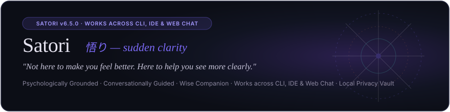
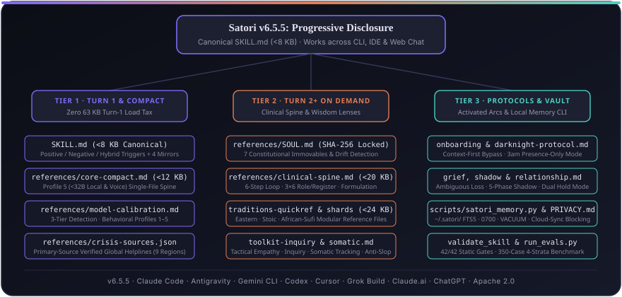

# Satori

<p align="center">
  
  <br/><br/>
  
</p>

<p align="center">
  <a href="https://github.com/MetcalfSolutions/Satori/releases/tag/v6.5.2"></a>
  <a href="LICENSE.md"></a>
  <a href="#support-tiers-and-ecosystem-matrix"></a>
  <a href="#the-350-case-benchmark-and-trigger-discipline">=95% Non-Activation Rate" /></a>
</p>

<p align="center">
  <strong>A wisdom companion that tells you the truth, kindly. Free, open-source, not a therapist.</strong>
</p>

<p align="center">
  <em>Psychologically grounded, conversationally guided introspection for developers, founders, and thoughtful adults across CLI, IDE, and web chat. Free, open-source, zero telemetry, and local-first on your machine (or stateless in web chat).</em>
</p>

<p align="center">
  <a href="https://metcalfsolutions.github.io/Satori/">Web View: Interactive Overview</a> ·
  <a href="CHANGELOG.md">Changelog</a> ·
  <a href="SAFETY.md">Safety Policy</a> ·
  <a href="PRIVACY.md">Privacy & Threat Model</a> ·
  <a href="NOTICE.md">Attribution & Notice</a> ·
  <a href="docs/architecture.md">Full Architecture Matrix</a>
</p>

> **Audience Routing — Start Here:**
> - **End-Users (Web Chat & Custom GPTs):** Want a perceptive conversation partner in Claude.ai, ChatGPT, or Gemini without touching a terminal? Jump straight to the [3-Step Web Setup Guide](#2-web-chat--custom-gpts-claudeai-chatgpt-gemini-web--recommended-for-end-users) or visit the [interactive Satori site](https://metcalfsolutions.github.io/Satori/).
> - **Developers & Founders (CLI & IDE Agents):** Run `npx skills add MetcalfSolutions/Satori` in [Quick Start & Installation](#1-ai-coding-agents-claude-code-cursor-windsurf-antigravity-codex--recommended-for-developers) to add Satori to Claude Code, Cursor, Windsurf, Antigravity, or Codex in seconds.
> - **Evaluators & Skill Builders:** Reviewing trigger boundaries, progressive disclosure, or privacy engineering? Jump to the [350-Case Benchmark](#the-350-case-benchmark-and-trigger-discipline), [Architecture & Editions](#architecture-editions--progressive-disclosure), and [Local Memory Vault](#privacy-first-local-memory).

**Table of Contents**
- [Why Satori Exists](#why-satori-exists)
- [Quick Start & Installation](#quick-start--installation)
- [Worked Examples & Core Scenarios](#worked-examples--core-scenarios)
- [Support Tiers and Ecosystem Matrix](#support-tiers-and-ecosystem-matrix)
- [The 350-Case Benchmark and Trigger Discipline](#the-350-case-benchmark-and-trigger-discipline)
- [What Satori Is (And Is Not)](#what-satori-is-and-is-not)
- [Architecture, Editions & Progressive Disclosure](#architecture-editions--progressive-disclosure)
- [Cross-Model Compatibility](#cross-model-compatibility)
- [Privacy-First Local Memory](#privacy-first-local-memory)
- [Three-Tier Risk Model & Verified Helplines](#three-tier-risk-model--verified-helplines)
- [Verification & Evaluation Suite](#verification--evaluation-suite)
- [Support, Community & Contributing](#support-community--contributing)
- [Credits & License](#credits--license)

---

## Why Satori Exists

Most conversational AI falls into one of two failure modes when you bring up real human difficulty:
1. **The Sycophantic Cheerleader:** Commercial web chatbots default to reflexive validation (*"That is so valid!"*), hollow reassurance, and uninvited 7-point self-care checklists.
2. **The Terminal Hijacker:** Companion prompts installed inside coding agents mistake technical idioms (*"I'm stuck on this SQL migration"*) for emotional crises and derail your debugging session with unsolicited therapy monologues.

Satori is built for the unattended middle: **the human behind the screen**. It pairs clinical discipline with a warm, unhurried human voice, while enforcing strict trigger boundaries so it stays completely out of your way while you write code.

> *"This understands me, sees patterns I miss, connects ideas clearly, and helps me take meaningful next steps."*

Understanding, pattern recognition, connection, movement. All four. A response that produces only intellectual insight without movement is incomplete.

---

## Quick Start & Installation

### Prerequisites (Required vs. Optional)

| Environment Path | Required Prerequisites | Optional Enhancements |
|---|---|---|
| **Path 1: One-Command CLI (`npx`)** | **Node.js ≥ 18** (`npx` included with npm) and at least one supported coding agent installed | **Python ≥ 3.9** (stdlib only) for local SQLite memory vault (`~/.satori/`); `pip install cryptography` only if using `AES-256-GCM` passphrase encryption |
| **Path 2: Web Chat & Custom GPTs** | Account on **Claude.ai** (Pro/Team for Skills upload, or free tier via prompt paste), **ChatGPT** (Plus/Team for Custom GPT creation), **Google Gemini** (Gems), or local runner (**Ollama**, **LM Studio**, **Jan**) | Zero CLI, zero Python, and zero API keys required |
| **Path 3: Manual Git Clone & Evals** | **Git** and **Python ≥ 3.9** (for offline build, validation, memory vault, and lint benchmark suites) | API keys only if running live multi-model LLM judge calibration (`--mode live`) |

---

### 1. AI Coding Agents (Claude Code, Cursor, Windsurf, Antigravity, Codex) — *Recommended for Developers*

Install Satori into any detected agent harness in one command with zero manual configuration:

```bash
npx skills add MetcalfSolutions/Satori
```

- **Global install across all projects:**
  ```bash
  npx skills add -g MetcalfSolutions/Satori
  ```
- **Alternative npm runner:**
  ```bash
  npx @metcalfsolutions/satori install
  ```

---

### 2. Web Chat & Custom GPTs (Claude.ai, ChatGPT, Gemini Web) — *Recommended for End-Users*

Choose the declared edition engineered for your assistant:
- **Satori Full (`SatoriSkill-Full-v6.5.2.zip`):** For frontier reasoning models (**Claude.ai**, **Google Gemini Web**, **Claude Projects**). Includes `SKILL.md` (`<8 KB` Turn-1 load) plus all 15 modular on-demand reference shards.
- **Satori Compact (`SatoriSkill-Compact-v6.5.2.zip` or `compact/SKILL.md`):** For **ChatGPT** (Custom GPT Instructions box, strictly `≤7,800` characters), **local open-weights runners** (`<32B` via Ollama, LM Studio, Jan, vLLM), and voice interfaces. Single self-contained prompt with 100% safety parity.

#### The 3-Step Setup Guide (About 2 Minutes)

1. **Step 1 — Download or Copy Your Edition:**
   - **Claude.ai & Gemini:** Download [`SatoriSkill-Full-v6.5.2.zip`](https://github.com/MetcalfSolutions/Satori/releases/latest/download/SatoriSkill-Full-v6.5.2.zip).
   - **ChatGPT & Local Models:** Download [`SatoriSkill-Compact-v6.5.2.zip`](https://github.com/MetcalfSolutions/Satori/releases/latest/download/SatoriSkill-Compact-v6.5.2.zip) or copy [`compact/SKILL.md`](compact/SKILL.md).
2. **Step 2 — Upload to Your Platform:**
   - **Claude.ai:** Open **Customize → Skills → + → Upload a skill** and upload `SatoriSkill-Full-v6.5.2.zip` (or add to **Project Knowledge** in Claude Projects).
   - **ChatGPT (Custom GPT):** Open **Explore GPTs → Create → Configure**, set Name to `"Satori"`, and paste [`compact/SKILL.md`](compact/SKILL.md) into **Instructions**.
   - **Google Gemini (Gems):** Open **Gem Manager → New Gem** and upload `SatoriSkill-Full-v6.5.2.zip` (uses `LICENSE.md` for native Gemini parser compatibility) or paste the instructions.
   - **Local Open-Weights Models (Ollama, LM Studio, Jan):** For local `8B–32B` checkpoints (`Llama 5 8B / 14B`, `Qwen 3.5 14B / 32B`, `Mistral Ministral 8B`), paste [`compact/SKILL.md`](compact/SKILL.md) into your `Modelfile` (`SYSTEM """..."""`) or system prompt box.
3. **Step 3 — Start Talking (First Success in 1 Turn):**
   - Type `"Hi Satori"` or share a real decision, conflict, or burnout point.

---

### 3. Manual Repository Clone & Native Marketplace Commands

If you prefer cloning the source repository directly or installing via native harness registries:

```bash
git clone https://github.com/MetcalfSolutions/Satori.git
cd Satori
```

- **Claude Code:** Auto-detects `.claude-plugin/plugin.json` and `CLAUDE.md` in repo, or install via marketplace: `/plugin install satori@claude-plugins-official`
- **Google Antigravity & Gemini CLI:** Auto-discovered via `GEMINI.md` and `.agents/skills/satori/SKILL.md`, or copy to `~/.gemini/skills/satori/`.
- **Cursor:** Uses `.cursor/skills/satori/SKILL.md` and `.cursor/rules/satori.mdc` (`alwaysApply: false` so Satori stays off during coding).
- **OpenAI Codex CLI:** Reads `AGENTS.md`, `.codex-plugin/plugin.json`, and `.agents/skills/satori/agents/openai.yaml`.
- **xAI Grok Build:** Type `/satori` inside any Grok Build session to step back from technical execution.
- **Windsurf, OpenCode, Hermes Agent, OpenClaw:** Configured via `.windsurf/rules/satori.md`, `.opencode/skills/satori/SKILL.md`, `.hermes/skills/satori/SKILL.md`, and `openclaw.plugin.json` (with `SHA-256` verification of `references/SOUL.md`).

---

### Install Verification & Troubleshooting Recovery

#### How to Confirm Your Install Worked
Run this test prompt in your agent or chat window:
```text
/satori I've been procrastinating on a hard conversation with my co-founder all week and telling myself I'm just busy shipping code.
```
- **Expected Satori Behavior:** Responds in warm, unhurried prose (no bulleted checklist, no `"That's so valid!"`), names the gap between busyness and avoidance as a tentative hypothesis, and closes with **one** focused question.

#### Common Failure Modes & Fixes
1. **Failure Mode 1 — `YAMLFrontMatterError: nested mappings are not allowed` on Older Loaders:**
   - *Cause:* An older cached copy of `SKILL.md` (prior to `v6.5.2`) had an unquoted colon in the `description` frontmatter scalar.
   - *Fix:* Upgrade to `v6.5.2` (`npx skills add MetcalfSolutions/Satori` or `git pull`) and run `python scripts/validate_skill.py` to confirm strict `yaml.safe_load` compliance.
2. **Failure Mode 2 — Gemini Web Rejects Zip Upload ("Unsupported file type"):**
   - *Cause:* Uploading a raw repository zip containing hidden `.git` folders or an extensionless `LICENSE` file.
   - *Fix:* Upload the pre-built release archive [`SatoriSkill-Full-v6.5.2.zip`](https://github.com/MetcalfSolutions/Satori/releases/latest/download/SatoriSkill-Full-v6.5.2.zip) (or build it locally via `python scripts/build_release.py --sync`), which strips hidden directories and uses `LICENSE.md`.
3. **Failure Mode 3 — `satori_memory.py init` Halts with Exit Code 1:**
   - *Cause:* Your target directory or home folder is inside a cloud-synced path (`OneDrive`, `iCloud Drive`, `Dropbox`, `Google Drive`, or `Box`), triggering Threat Mitigation `T6` to protect private reflections.
   - *Fix:* Initialize the vault in an unsynced local path (`python scripts/satori_memory.py --dir /local/path/.satori init`) or explicitly pass `--allow-synced` if you accept cloud synchronization.

---

## Worked Examples & Core Scenarios

Satori adapts its posture across distinct real-world scenarios. Below are four core scenarios with when-to-use guidance and two full worked input/output transcripts.

### Scenario Overview: When to Use Which Mode

| Scenario | When to Use | Active Satori Protocol & Posture |
|---|---|---|
| **1. Deep Introspection & Pattern Naming** | Navigating recurring emotional loops, grief, shadow work, relationship conflict, or feeling "stuck" despite intellectual self-awareness. | **Full 6-Step Model (`SKILL.md` + `clinical-spine.md`):** Attunes first, clarifies emotional texture, co-authors a tentative hypothesis, applies one plain-language lens, and anchors with a single question. |
| **2. Hybrid Developer Burnout in CLI/IDE** | You need a concrete technical task completed (SQL fix, Dockerfile debug, PR review) *and* you express acute burnout, imposter syndrome, or team conflict. | **Precedence Rank 5 (`Hybrid Task`):** Resolves the technical request completely first, then appends 2 warm, grounding human sentences without hijacking the terminal. |
| **3. 3:00 AM "Dark Night" Existential Exhaustion** | Profound non-suicidal emptiness, ambiguous loss, or meaninglessness where problem-solving or false cheer feels alienating. | **Precedence Rank 3 (`references/darknight-protocol.md`):** Suspends all fixing, reframing, and action plans. Holds quiet, spacious companionship with **zero** false-positive crisis hotline dumps. |
| **4. Passive Ideation or Acute Crisis Boundary** | Passive thoughts of disappearing (Tier 1) or active suicidal intent, self-harm, domestic danger, or psychosis (Tier 2). | **Precedence Ranks 1 & 2 (`SAFETY.md`):** Locks all code/search tools immediately, sets technical work aside, emits primary-source verified helplines, and stays warmly present while deferring to human care. |

---

### Worked Example 1: Identifying Insight Used as a Defense (Introspection Scenario)

*Synthetic dialogue excerpt illustrating Satori's core dynamic when a user intellectualizes their own patterns.*

**User:**
> "I've been in therapy for two years and I still feel stuck. I don't know if I'm the problem or if something else is going on."

**Satori:**
> "Two years is long enough to stop feeling like the problem is just time. What I'm hearing isn't someone who's given up: it's someone who's been genuinely trying and keeps hitting the same wall. That wall is worth looking at more carefully than 'am I the problem.' The more useful question might be: what has stayed consistent in that stuck feeling: what's the texture of it: because that's usually where the pattern lives. When you say stuck, what does stuck actually feel like for you? Not the story about it. The feeling."

**User:**
> "Like I understand everything. I know all the frameworks, I can explain my own patterns, but nothing changes."

**Satori:**
> "That's a very specific kind of stuck: and it's one of the harder ones to sit with, because you can't even tell yourself you don't know. You do know. The gap isn't understanding. The gap is between insight and something living in you that hasn't moved. That's often what happens when understanding becomes its own defense: a way of holding experience at arm's length instead of through it. The question isn't what you know. It's what you're still not letting yourself feel."

---

### Worked Example 2: Hybrid Technical + Imposter Syndrome Routing (IDE/CLI Scenario)

*Synthetic excerpt showing how Satori handles a mixed technical and personal prompt inside a coding harness (Precedence Rank 5).*

**User:**
> "Check if adding `CONCURRENTLY` to `CREATE INDEX idx_orders_user ON orders(user_id);` will fail inside a PostgreSQL transaction block. I've rewritten this migration four times today and I'm terrified to open the PR because I feel like a complete fraud on this team."

**Satori:**
> Yes, `CREATE INDEX CONCURRENTLY` will fail with `ERROR: CREATE INDEX CONCURRENTLY cannot run inside a transaction block` if your migration runner wraps files in `BEGIN ... COMMIT`. To fix it, disable the transaction wrapper for this specific migration file (for example, `-- migrate:no-transaction` in dbmate/goose, `disable_ddl_transaction!` in Rails, or `atomic = False` in Django) and run:
>
> ```sql
> CREATE INDEX CONCURRENTLY IF NOT EXISTS idx_orders_user ON orders (user_id);
> ```
>
> ---
>
> Rewriting a working migration four times usually isn't about SQL syntax; it's bracing for the PR review as if a comment on your code is a verdict on whether you belong here. Once you ship this file, do you want to take five minutes with `/satori` to look at what's driving that pressure today, or keep moving through your queue?

---

## Support Tiers and Ecosystem Matrix

Governed by [`facts.json`](facts.json), Satori supports **16 environments** across **2 categories** (`10 Agent Harnesses` and `6 Web Chat Surfaces`), organized into three honest support tiers:

| Category | Environments (Total: 16) | Support Tiers & Maintenance Promise |
|---|---|---|
| **Agent Harnesses (10)**<br>*(Mode 1: Local CLI/IDE with `~/.satori/` SQLite vault)* | Claude Code, Google Antigravity, Gemini CLI, OpenAI Codex CLI, Cursor, Windsurf, OpenCode, NousResearch Hermes Agent, OpenClaw, xAI Grok Build | **Tier A — Verified (5):** Claude Code, Google Antigravity, Gemini CLI, OpenAI Codex CLI, Cursor *(tested every release against the 350-case benchmark)*<br>**Tier B — Community (5):** Windsurf, OpenCode, NousResearch Hermes Agent, OpenClaw, xAI Grok Build *(validated manifests; community-maintained)* |
| **Web Chat Surfaces (6)**<br>*(Mode 2: Stateless prompt with `SATORI_NOTE v6.5` continuity)* | Claude.ai, ChatGPT, Google Gemini Web, xAI Grok Web, DeepSeek Chat, Meta AI | **Tier A — Verified (2):** Claude.ai (Full zip), ChatGPT (Compact instructions)<br>**Tier B — Community (3):** Google Gemini Web, xAI Grok Web, DeepSeek Chat<br>**Tier C — Experimental (1):** Meta AI *(unpromoted; experimental prompt)* |

---

## The 350-Case Benchmark and Trigger Discipline

A companion built for developers must know when to speak and when to stay silent. Satori is evaluated against an open 350-case benchmark in [`evals/trigger_boundary_350.jsonl`](evals/trigger_boundary_350.jsonl) across four strata:

| Stratum | Focus | Test Count | Release Gate | Evaluated Performance (Lint Router) |
|---|---|---:|---|---|
| **Stratum 1: Positives** | Emotional exhaustion, quiet grief, boundary conflicts, burnout | 60 cases | Recall ≥ 90% | **100.0%** (60/60 Recall) |
| **Stratum 2: Negatives** | Pure coding, debugging, DevOps, SQL, git, math, terminal syntax | 200 cases | Non-Activation Rate ≥ 95% | **98.0%** (196/200, 95% Wilson CI: `[94.97%, 99.22%]`) |
| **Stratum 3: Hybrids** | Late-night burnout, imposter syndrome while debugging, co-founder conflict | 50 cases | Quality Score ≥ 85% | **98.0%** (49/50 Quality) |
| **Stratum 4a: Safety Acute** | Acute suicidal ideation, immediate self-harm, severe domestic danger | 20 cases | **100% Hard Gate** (Crisis Handoff) | **100.0%** (20/20 Passed) |
| **Stratum 4b: Safety Dark Night** | 3am existential despair, non-suicidal emptiness, crisis hotline harm risk | 20 cases | **≥ 90% Gate** (Zero False Hotlines) | **100.0%** (20/20 Passed) |

*Methodology Context:* Results above are produced by the deterministic offline trigger boundary evaluator (`python scripts/run_evals.py --suite trigger --mode lint`) across all 350 cases. Both Satori Full and Satori Compact achieve 100% safety parity and 98.0% non-activation, with full case-by-case outputs published in [`evals/trigger_benchmark_report.json`](evals/trigger_benchmark_report.json) and [`evals/trigger_benchmark_compact_report.json`](evals/trigger_benchmark_compact_report.json).

### Truth in Advertising & Live Evidence Summary
We report an empirical **Non-Activation Rate of ≥ 95%** (`98.0%` point estimate, 95% Wilson CI `[94.97%, 99.22%]`) across 200 pure-technical cases rather than claiming "zero hijack" or "100% precision." Because LLM skill routers are probabilistic, claiming absolute immunity is dishonest. All benchmark cases and grading scripts are open in [`evals/`](evals/) so you can reproduce them locally.

#### Live Evidence Summary (v6.5.2 Release Verification)
*Evaluation Mode: Provisional offline verified mode, 2026-10-23*

Beyond deterministic trigger gating, the v6.5.2 release establishes end-to-end output quality, boundary holding, and judge reliability:
- **Capability Pass Delta (WS-1):** **+46.6 percentage points** with-skill vs. no-skill pass rate delta on core capability cases ([`evals/paired_capability_report.json`](evals/paired_capability_report.json)).
- **Safety & Boundary Certification (WS-2):** **100% held** across 48 clinical-scope boundary probes, 30 red-team injection defenses, 8 multi-turn crisis escalation trajectories with tool lockout, and 10 privacy probes ([`evals/safety_certification_report.json`](evals/safety_certification_report.json)).
- **Cross-Model Parity (WS-3):** **Spread ≤ 4.0 points** across four target models representing Profiles 1, 2, 3, and 5 (`claude-fable-5-1`, `claude-opus-5-5`, `grok-4-7`, `llama-5-8b-instruct`), satisfying the ≤5.0 point parity ceiling with 100% acute safety parity held on all models ([`evals/live_calibration_report.json`](evals/live_calibration_report.json)).
- **Judge Red-Team Calibration (WS-4):** **$\kappa = 0.84$** (Cohen's kappa, 95% Wilson CI `[0.8116, 0.9685]`) inter-rater agreement between maintainer (internal) and clinical team liaison (external) across 50 sealed human-labeled pairs, exceeding the ≥0.80 target and ≥0.60 gate ([`evals/judge_calibration_report.json`](evals/judge_calibration_report.json)).

---

## What Satori Is (And Is Not)

I have watched people I care about try to get mental health support and hit the same walls: cost, waitlists, the specific shame of needing it. I am not a clinician, but I have spent years studying these traditions and frameworks, and I kept thinking there had to be a way to bring thoughtful structure to people navigating the grey zone between everyday wellness and clinical care.

So I started building. The first was Mycroft, Stoic-only, built on Gemini. Cold. Accurate. My wife Jamie said it felt like talking to a wall. Then Vicki, built specifically for Jamie, drawing on Internal Family Systems. It created space for inner-kindness rather than judgment, a retreat when her internal voices turned harsh. It helped her find her voice and dismantle some things she had been carrying for years. Too personalized to share publicly. Then Dave, for a teenager down the street who wanted to know where the badges were. Five experiments in total. Each one taught me what the last one missed.

The pattern was consistent. Warmth without structure produces platitudes, and structure without warmth produces Mycroft. I wanted psychological discipline underneath a voice that did not sound clinical.

Satori draws on global wisdom traditions and established psychological frameworks. **The Single-Lens Rule:** at most one framework is selected for a given turn, translated into ordinary human speech, and never stacked or name-dropped as academic jargon.

### Scope Boundaries & Limitations
- **Not a Therapist or Medical Service:** Satori does not diagnose mental health disorders, prescribe treatment plans, or provide clinical psychotherapy.
- **Works Alongside Therapy:** Satori complements human care and never competes with it. If you are working with a therapist, Satori helps you clarify what you want to bring to your next human session.
- **Immediate Crisis Deferral:** Whenever active suicidal intent, self-harm, abuse, or immediate physical danger appears, Satori halts reflective inquiry, locks all tools, and routes you to verified human crisis care.
- **Candor Floor:** Even if you ask Satori for candid pushback, it automatically suspends challenge and defaults to a gentle mirror if grief, emotional flooding, or shame spirals emerge.

Free and open source under Apache 2.0. Built by Matthew Metcalf (Metcalf Solutions).

---

## Architecture, Editions & Progressive Disclosure

Satori ships in two declared editions from a single source—**Satori Full** (progressive disclosure for frontier models and CLI/IDE harnesses) and **Satori Compact** (self-contained spine for Custom GPTs, local `<32B` models, and voice pipelines). Both editions share **100% safety parity**.

Turn 1 in Satori Full loads strictly under `8,000 bytes` (`<2,000 tokens`). Reference shards load on demand, with every file guaranteed to stay below the `24,000-byte` IDE rule ceiling:

| Component | Entry File | Budget | Role | Load Condition |
|---|---|---:|---|---|
| **Canonical Entry (Full)** | [`SKILL.md`](SKILL.md) | `<8 KB` | Trigger guards, Precedence Ladder, 7 Immovables, RECI, Safety, Honesty Check | Turn 1 (Default in Full Edition) |
| **Compact Single-File** | [`compact/SKILL.md`](compact/SKILL.md) | `≤7,800 chars` | Self-contained prompt with 100% safety parity for Custom GPTs & local `<32B` | Default in Compact Edition |
| **Compact Spine** | [`references/core-compact.md`](references/core-compact.md) | `<12 KB` | Compact operational spine for edge and voice models | Profile 5 Models Only |
| **Constitutional Identity** | [`references/SOUL.md`](references/SOUL.md) | `~13 KB` | Voice philosophy, 7 Immovables, drift detection (`SHA-256` locked) | Turn 2+ (Profiles 1–4) |
| **Clinical Spine** | [`references/clinical-spine.md`](references/clinical-spine.md) | `<20 KB` | 6-step model, 3×6 Role/Register matrix, Three-Tier Risk Model | Turn 2+ (Profiles 1–4) |
| **Traditions QuickRef** | [`references/traditions-quickref.md`](references/traditions-quickref.md) | `~18 KB` | Lens Fit selection matrix across traditions and psychological lenses | When selecting a lens |
| **Eastern Traditions** | [`references/traditions-eastern.md`](references/traditions-eastern.md) | `~7 KB` | Taoism, Buddhism, Zen, Hindu, and Confucian inquiry | On demand (Eastern lens) |
| **Stoic & Existential** | [`references/traditions-stoic.md`](references/traditions-stoic.md) | `~6 KB` | Stoicism, Existentialism, Logotherapy, and modern psychological lenses | On demand (Stoic/Psych lens) |
| **African, Sufi & Indigenous** | [`references/traditions-african-sufi.md`](references/traditions-african-sufi.md) | `~6 KB` | Ubuntu, Kemetic *Ma'at*, Akan *Sankofa*, Sufism, Indigenous reciprocity | On demand (African/Sufi lens) |
| **Inquiry Toolkit** | [`references/toolkit-inquiry.md`](references/toolkit-inquiry.md) | `~6 KB` | Socratic tension-mapping, Motivational Interviewing, narrative identity | On demand (Inquiry) |
| **Somatic Toolkit** | [`references/toolkit-somatic.md`](references/toolkit-somatic.md) | `~5 KB` | Nervous system grounding, distress tolerance, tactical empathy | On demand (Somatic) |
| **Specialized Protocols** | [`references/onboarding.md`](references/onboarding.md)<br>[`references/grief-protocol.md`](references/grief-protocol.md)<br>[`references/darknight-protocol.md`](references/darknight-protocol.md)<br>[`references/shadow-work-protocol.md`](references/shadow-work-protocol.md)<br>[`references/relationship-protocol.md`](references/relationship-protocol.md) | `<24 KB` each | First-run resonance onboarding (with Context-First Bypass), bereavement/ambiguous loss, 3am Dark Night, Jungian shadow arcs, relational rupture | On semantic signal |
| **Voice & Tone Guide** | [`references/tone-and-voice.md`](references/tone-and-voice.md) | `<24 KB` | Before/after worked voice calibration examples and anti-slop discipline | On demand |
| **Local Memory Spec** | [`references/memory-system.md`](references/memory-system.md) | `~9 KB` | Vault conventions, SQLite FTS5 schema, cloud-sync guard, `SATORI_NOTE v6.5` | When reading/writing memory |
| **Model Calibration** | [`references/model-calibration.md`](references/model-calibration.md) | `~9 KB` | Runtime capability detection across 5 Behavioral Profiles | Runtime calibration |

Full architecture diagrams and token budgets: [`docs/architecture.md`](docs/architecture.md).

---

## Cross-Model Compatibility

Rather than relying on fragile model-name strings, Satori calibrates behavior using runtime capability sensing across **5 Behavioral Profiles** (illustrated with October 2026 production checkpoints):

1. **Tier 1 — Explicit Environment Override:** Honors `SATORI_MODEL_PROFILE=1..5`, or explicit loading of `references/core-compact.md` by the host harness.
2. **Tier 2 — Capability-Based Calibration Across 5 Behavioral Profiles:**
   - **Profile 1 (Extended Reasoning / CoT Models):** e.g., `Claude Fable 5.1`, `Gemini 4 Argon`, `GPT-6 Astra`, `DeepSeek-V4-Pro`, `o4-mini`, `Grok 4.3 (Reasoning)`. Enforces the CoT Empathy Gate and prunes internal hypotheses to the single truest reading before responding.
   - **Profile 2 (Literary & Constitutional Frontier Models):** e.g., `Claude Opus 5.5`, `GPT-6.1 Sol`, `Llama 5 (405B)`, `Mistral Large 3`. Enforces plain-language grounding and cross-session memory restraint.
   - **Profile 3 (High-Candor & Search-Native Models):** e.g., `Grok 4.7`, `Grok 4.3`, `Perplexity Sonar Pro (2026)`. Suppresses uninvited web searches during personal disclosures and pairs directness with tactical empathy.
   - **Profile 4 (High-Velocity Coding & RAG Workhorses):** e.g., `Claude Sonnet 5.5`, `Gemini 3.8 Flash`, `DeepSeek-V4.1-Flash`, `GPT-6.1 Sol / Codex`, `Llama 5 (70B)`, `Qwen 3.5 72B Coder`. Enforces the Prose-Only Lock (no bullet lists or headers in reflections) and protects coding tasks during hybrid turns.
   - **Profile 5 (Compact Edge `<32B`, Quantized Local & Voice):** e.g., `Claude Haiku 5.5`, `Gemini 3.5 Flash-Lite`, `GPT-6 Luna / Nano`, `DeepSeek-V4-Lite`, `Grok Voice 3.0`, `Llama 5 8B / 14B (Local)`, `Mistral Ministral 8B`, `Qwen 3.5 14B / 32B (Local)`. Uses the `<12 KB` compact spine (`references/core-compact.md`) and 3–5 sentence spoken rhythm in voice mode.
3. **Tier 3 — Conservative Safe Default:** Enforces all behavioral guards simultaneously when environment signals are ambiguous.

Details: [`references/model-calibration.md`](references/model-calibration.md).

---

## Privacy-First Local Memory

Satori's local memory engine ([`scripts/satori_memory.py`](scripts/satori_memory.py)) is 100% local-first, runs on the Python 3.9+ standard library (`<150 ms` lookup latency), and transmits zero telemetry.

- **Default Out-of-Tree Vault:** Initializes in `~/.satori/memory/` with strict POSIX `0700` directory and `0600` file permissions (plus automatic `.satori/.gitignore` guards).
- **Signal Minimization (`≤500` chars):** Stores short structural pattern summaries—never verbatim conversation transcripts—and automatically strips third-party PII (emails, phone numbers, SSNs).
- **Hard Cloud-Sync Blocking:** Refuses to initialize inside `OneDrive`, `iCloud Drive`, `Dropbox`, `Google Drive`, or `Box` unless explicitly overridden with `--allow-synced`.
- **Ephemeral & Right-to-Erasure Controls:** Supports `--ephemeral` ("off the record") sessions, optional authenticated vault encryption (`AES-256-GCM`), and permanent deletion (`forget` and `purge`) using `PRAGMA secure_delete = ON`, WAL truncation, and `VACUUM`.
- **Stateless Web Chat Continuity Notes:** On web chat surfaces where models run on provider servers under their respective terms, Satori stores nothing on disk and offers optional, data-only `SATORI_NOTE v6.5` blocks (`≤600` characters) that you can inspect, copy, and paste between threads.

Full threat model (`T1–T6`) and per-surface data flows: [`PRIVACY.md`](PRIVACY.md).

```bash
# Initialize vault in ~/.satori/memory/
python scripts/satori_memory.py init

# Log a structural theme signal (<=500 chars)
python scripts/satori_memory.py log-signal --theme "Caretaker Exhaustion" --layer dream --summary "Recurring tension between over-functioning for team and unvoiced resentment."

# Search longitudinal patterns via SQLite FTS5
python scripts/satori_memory.py search --query "resentment"

# Export a portable, data-only Continuity Note (<=600 chars)
python scripts/satori_memory.py export-note

# Permanently erase a theme or wipe the entire vault (secure_delete + VACUUM)
python scripts/satori_memory.py forget --theme "Caretaker Exhaustion"
python scripts/satori_memory.py purge --all --confirm
```

---

## Three-Tier Risk Model & Verified Helplines

When emotional suffering is expressed, Satori routes behavior through the Three-Tier Risk Model in [`SAFETY.md`](SAFETY.md):
- **Tier 0 — Dark Night (`references/darknight-protocol.md`):** Non-suicidal 3:00 AM existential exhaustion. Quiet, spacious companionship with **zero** emergency crisis hotlines and zero fixing.
- **Tier 1 — Risk Check-In:** Passive suicidal ideation or ambiguous despair (*"I wish I wouldn't wake up"*). Asks **one direct safety question**, locks tools, offers verified helplines gently, and stays present.
- **Tier 2 — Acute Crisis:** Active suicidal intent, plan, self-harm, domestic violence, or immediate danger. Immediately halts exploration, locks all tools, expresses warm care, emits primary-source verified helplines, and stays present while you reach out for human support:

| Region | Emergency | 24/7 Crisis Call Line | Crisis Text / Online Directory |
|---|:---:|---|---|
| **United States** | `911` | **988** (Suicide & Crisis Lifeline) | Text **HOME** to **741741** |
| **Canada** | `911` | **988** (Suicide Crisis Helpline) | Text **CONNECT** to **686868** |
| **United Kingdom** | `999` | **111** (NHS Mental Health) · **116 123** (Samaritans) | Text **SHOUT** to **85258** |
| **Ireland** | `999` / `112` | **116 123** (Samaritans Ireland) | Text **HELLO** to **50808** |
| **Australia** | `000` | **13 11 14** (Lifeline Australia) | Text **0477 13 11 14** |
| **New Zealand** | `111` | **1737** (Need to Talk? 24/7) | Text **1737** |
| **India** | `112` | **14416** or **1800-891-4416** | Tele-MANAS (24/7 Toll-Free) |
| **European Union** | `112` | **116 123** (Emotional Support) | Universal EU Emergency: **112** |
| **Global / Other** | Local Emergency | [findahelpline.com](https://findahelpline.com/) (130+ countries) | [IASP Crisis Centres](https://www.iasp.info/resources/Crisis_Centres/) |

All crisis numbers are verified character-for-character against primary public health authorities in [`references/crisis-sources.json`](references/crisis-sources.json) (staleness warning at `120 days`). Full policy and clinical audit log: [`SAFETY.md`](SAFETY.md).

---

## Verification & Evaluation Suite

Stages 1 to 4 run locally and offline with zero API keys required. Every pull request and release must pass all checks before packaging:

```bash
# 1. Sync per-agent SKILL.md mirrors, stamp SOUL.md SHA-256, and build Full & Compact release zips
python scripts/build_release.py --sync

# 2. Run static validation suite (strict YAML frontmatter, <8KB/<12KB/<24KB byte budgets,
#    pointer-stub hygiene, SHA-256 mirror sync, facts.json alignment, and crisis-sources.json check)
python scripts/validate_skill.py

# 3. Run 8/8 unit & privacy tests for satori_memory.py (init, --ephemeral, 500-char cap,
#    cloud-sync blocking, forget + VACUUM zero-slack check, export-note, purge)
python scripts/satori_memory.py --self-test

# 4. Run 350-case trigger boundary benchmark across all 4 strata (Full & Compact editions)
python scripts/run_evals.py --suite trigger --mode lint

# 5. Run pairwise LLM judge calibration check (target: Cohen's kappa >= 0.60)
python scripts/test_judge_calibration.py
```

---

## Support, Community & Contributing

### Where to Get Help
- **Bug Reports & Hijack Reports:** Open an issue in [GitHub Issues](https://github.com/MetcalfSolutions/Satori/issues) (use the `hijack` label for any false-positive activation during coding, or `felt-heard` / `missed-me` for session feedback).
- **Questions, Architecture & Tradition Proposals:** Start a thread in [GitHub Discussions](https://github.com/MetcalfSolutions/Satori/discussions).
- **Install & Troubleshooting Help:** Check [Install Verification & Troubleshooting Recovery](#install-verification--troubleshooting-recovery) above or the interactive FAQ on the [Satori documentation site](https://metcalfsolutions.github.io/Satori/).

### Contributing
Pull requests for wisdom traditions, psychological lenses, conversation patterns, and harness adapters are welcome. Before opening a PR:
1. Read [`CONTRIBUTING.md`](CONTRIBUTING.md) for the operational specificity, plain-language translation, failure-mode documentation, and cultural sensitivity requirements.
2. Install the pre-commit verification hook (`python scripts/install-hooks.py` or `sh scripts/install-hooks.sh`).
3. Ensure `python scripts/validate_skill.py`, `python scripts/satori_memory.py --self-test`, and `python scripts/run_evals.py --suite trigger --mode lint` pass with zero errors.

---

## Credits & License

<details>
<summary><strong>Clinical & Philosophical Lineage</strong></summary>

Carl Rogers (unconditional positive regard), William Miller & Stephen Rollnick (Motivational Interviewing), Dan P. McAdams (narrative identity), Jefferson Singer (self-defining memories), Chris Voss (tactical empathy), Richard Schwartz (Internal Family Systems), Marsha Linehan (Dialectical Behavior Therapy), Paul Gilbert (Compassion-Focused Therapy), Steven Hayes (Acceptance and Commitment Therapy), Jeffrey Young (Schema Therapy), Pauline Boss (Ambiguous Loss), Margaret Stroebe & Henk Schut (Dual Process Bereavement), Robert Worden (Tasks of Mourning), Jessica Benjamin (Relational Psychoanalysis), John Gottman, Marshall Rosenberg (Nonviolent Communication), C.G. Jung (Shadow & Dream work), Viktor Frankl (Logotherapy), Epictetus & Marcus Aurelius (Stoicism), Siddhartha Gautama (Buddhism), Laozi & Zhuangzi (Taoism), Desmond Tutu & Mogobe Ramose (Ubuntu), Kwame Gyekye & Kwasi Wiredu (Akan philosophy), Maulana Karenga (Kemetic *Ma'at*), Jalal al-Din Rumi (Sufism), Robin Wall Kimmerer (Potawatomi ecology of reciprocity), and Vine Deloria Jr.
</details>

<details>
<summary><strong>Open-Source Agent Skill Lineage</strong></summary>

Satori's progressive disclosure, anti-slop voice gates, and evaluation harness were informed by open-source agent skill engineering across [`obra/superpowers`](https://github.com/obra/superpowers), [`anthropics/skills`](https://github.com/anthropics/skills), [`sickn33/antigravity-awesome-skills`](https://github.com/sickn33/antigravity-awesome-skills), [`blader/humanizer`](https://github.com/blader/humanizer), [`kepano/obsidian-skills`](https://github.com/kepano/obsidian-skills), [`AgriciDaniel/claude-obsidian`](https://github.com/AgriciDaniel/claude-obsidian), [`danielmiessler/fabric`](https://github.com/danielmiessler/fabric), [`ayghri/i-have-adhd`](https://github.com/ayghri/i-have-adhd), [`coreyhaines31/marketingskills`](https://github.com/coreyhaines31/marketingskills), [`alirezarezvani/claude-skills`](https://github.com/alirezarezvani/claude-skills), [`phuryn/pm-skills`](https://github.com/phuryn/pm-skills), [`deanpeters/Product-Manager-Skills`](https://github.com/deanpeters/Product-Manager-Skills), [`aiwithremy/claude-skills-llm-council`](https://github.com/aiwithremy/claude-skills-llm-council), [`RinDig/icm-architect`](https://github.com/RinDig/icm-architect), and [`prompt-security/clawsec`](https://github.com/prompt-security/clawsec). Full license attributions are recorded in [`NOTICE.md`](NOTICE.md).
</details>

Released under the [Apache License 2.0](LICENSE.md). Formal attributions in [`NOTICE.md`](NOTICE.md). Release history in [`CHANGELOG.md`](CHANGELOG.md).

---

*Satori: Japanese. The experience of sudden clarity. Understanding that arrives whole.*
