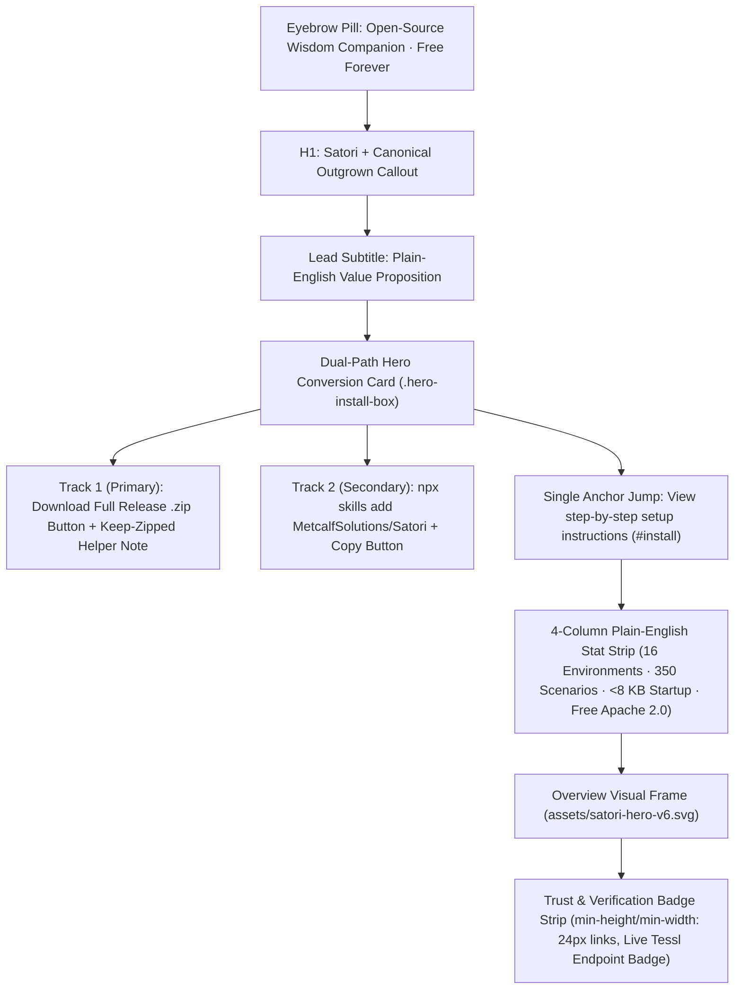
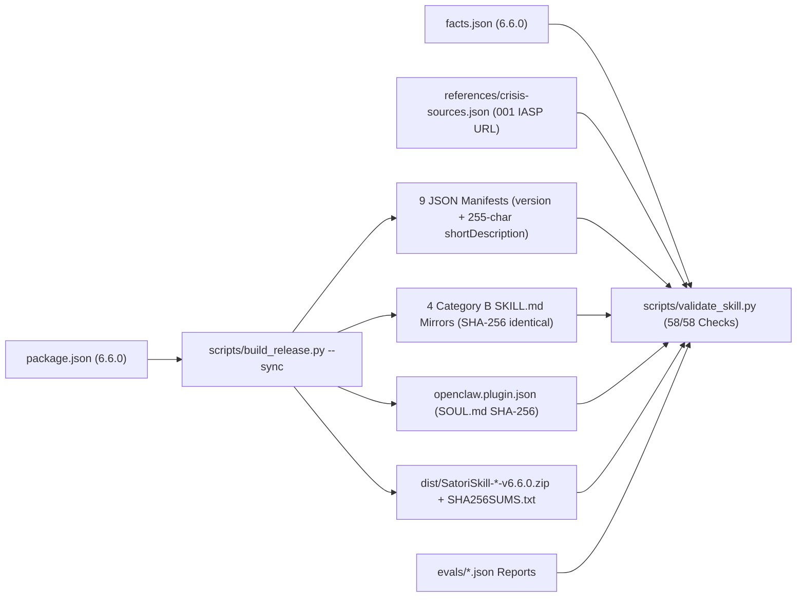

# Satori v6.6.0: GitHub Pages Visual & Conversion Overhaul, Web Chat Skills Alignment & Release Engineering

*   **Author:** Matthew Metcalf (`@MetcalfSolutions`)
*   **Status:** Proposed
*   **Date:** 2026-11-02

---

## Overview

Satori v6.6.0 overhauls the public GitHub Pages site ([`docs/index.html`](../index.html)), synchronizes [`README.md`](../../README.md) and [`docs/architecture.md`](../architecture.md), adds a custom [`docs/404.html`](../404.html) error page, and executes the open release engineering, link verification, and repository hygiene tasks defined in the Issue Register (`001`–`020`).

The central purpose of this release is to improve discoverability and installation conversion for less technical visitors on both desktop and mobile viewports while preserving Satori's engineering verification standards. The redesigned [`docs/index.html`](../index.html) leads above the fold with Satori's positioning tagline (*"Built to be outgrown."*) and a dual-path installation card: featuring the direct download link first for the Full Release archive (`SatoriSkill-Full-v6.6.0.zip`) for web chat users (`claude.ai`, `gemini.google.com`, `chatgpt.com`), followed by the terminal installation command (`npx skills add MetcalfSolutions/Satori`) with a copy button, and a single anchor jump link to detailed setup instructions.

## The Problem

Satori operates across both developer agent harnesses (`Claude Code`, `Antigravity`, `Cursor`, `Codex`) and consumer web chat interfaces (`Claude.ai`, `Google Gemini Web`, `ChatGPT`). However, the v6.5.5 public landing page ([`docs/index.html`](../index.html)) and repository documentation ([`README.md`](../../README.md)) exhibit five conversion and maintenance defects:

1.  **Developer-Only Above-the-Fold Presentation:** The current [`docs/index.html`](../index.html) hero section opens with an `820px` technical architecture diagram (`satori-hero-v6.svg`) and six developer CI shield badges before displaying the `<h1>Satori</h1>` heading, and offers only the terminal command (`npx skills add MetcalfSolutions/Satori`) in the primary install box. Non-technical web chat visitors have no direct `.zip` download path above the fold and encounter terminal-styled code containers around personal dialogue examples.
2.  **Outdated Web Chat Instructions:** Both [`docs/index.html`](../index.html) and [`README.md`](../../README.md) reference deprecated Google Gemini Gems (`Gem Manager`) instead of the November 2026 Skills upload workflows supported across `claude.ai`, `gemini.google.com`, and `chatgpt.com`. Furthermore, the installation section leads with the 10-harness developer matrix rather than web chat setup.
3.  **High Cognitive Load & Static Benchmark Badges:** Public documentation sections expose internal compiler and statistical jargon (`Lint Router`, `95% Wilson CI`, `POSIX 0700/0600`, `Precedence Rank 5`, `Mode 1 / Mode 2`, `SATORI_NOTE v6.5`, and four detailed benchmark metric cards) alongside hardcoded static Tessl evaluation numbers that violate Standing Constraint #3.
4.  **Mobile Layout & Accessibility Gaps:** On narrow mobile viewports (`320px` to `560px`), 5-column data tables lack a `min-width` style and collapse into 2-character columns, `.badge-strip` anchor links measure `20px` tall (below the WCAG 2.2 AA `24x24 CSS px` minimum), and fixed `scroll-padding-top: 120px` causes the sticky CTA bar to obscure section headings on anchor jumps.
5.  **Unresolved v6.6.0 Release Engineering & Link Integrity Issues:** As cataloged in the Issue Register below, the International Association for Suicide Prevention (IASP) crisis directory URL (`https://www.iasp.info/resources/Crisis_Centres/`) redirects to the IASP homepage across 15 occurrences in 13 files (`001`); [`facts.json`](../../facts.json) lacks automated synchronization checks against `evals/*.json` (`006`); [`scripts/build_release.py`](../../scripts/build_release.py) only syncs 7 of the 9 manifests and does not update version strings inside `interface.shortDescription` and `interface.longDescription` (`007`); no custom [`docs/404.html`](../404.html) exists (`011`); `dev` lags `main` by 2 commits (`005`) and lacks the `aria-label` on the `README.md` hero anchor (`012`); and CI lacks both an external link/redirect checker (`017`) and a release tag immutability guard (`019`).

## Goals

*   **G1 (Visual & Conversion Overhaul of `docs/index.html`):** Redesign [`docs/index.html`](../index.html) with an editorial hero layout (headline and canonical *"Built to be outgrown."* copy above the fold, primary `SatoriSkill-Full-v6.6.0.zip` download button, secondary `npx skills add MetcalfSolutions/Satori` copy box, and single `#install` jump link, moving the `820px` SVG and badge strip below the CTA card), WCAG 2.2 AA automatic dark/light theming (defaulting to dark mode), conversational message bubble styling for Worked Example 1, semi-transparent card backgrounds, and visual 3-platform Web Chat Skills setup cards.
*   **G2 (November 2026 Web Chat Skills Alignment & Streamlined Install Flow):** Reorder both Position 2 (`#surface-chooser`) and Position 10 (`#install`) in [`docs/index.html`](../index.html) and [`README.md`](../../README.md) to: (1) Web Chat Full Zip Setup (`claude.ai`, `gemini.google.com`, `chatgpt.com` Skills with official documentation links and explicit *"do not unzip"* guidance), (2) CLI/Terminal Agents (`npx skills add`), (3) ChatGPT Custom GPTs & Single-Prompt Compact Edition (`<= 7,800 Chars`), (4) 16-Surface Matrix Table, and (5) Local CLI/IDE Git Clone & Vault Initialization. Remove all deprecated "Gemini Gems" / "Gem Manager" references across `docs/index.html`, `README.md`, `docs/architecture.md`, `docs/assets/satori-hero-v6.svg`, FAQ, and JSON-LD.
*   **G3 (Cognitive Load Reduction & Tessl Live-Badge Compliance):** Remove the four benchmark cards (`Capability Lift`, `Judge Calibration`, `Multi-Model Calibration`, `Automated CI Validator`) from [`docs/index.html`](../index.html) and add a link to the GitHub repository [`evals/`](../../evals) directory below the benchmark table; remove all hardcoded Tessl scores and static score badges from `docs/index.html` and `README.md` so only the live Tessl endpoint badge remains; collapse Position 9 (Token Budgets) and Position 13 (Offline Verification) inside accessible `<details class="section-accordion">` disclosures while keeping `<h2>` landmarks visible; and translate remaining public table jargon into plain English.
*   **G4 (Mobile Viewport & WCAG 2.2 AA Polish):** Enforce `min-width: 620px` on `.table-wrap table` for smooth horizontal scrolling on `320px` screens, `min-height: 24px` and `min-width: 24px` touch targets on `.badge-strip a`, responsive `scroll-padding-top` so `#sticky-cta` never obscures headings, and create a themed [`docs/404.html`](../404.html) (`011`) plus the `README.md` hero anchor `aria-label` (`012`).
*   **G5 (Release Engineering, IASP Fix & 58/58 Validation):** Atomically replace the dead IASP URL across all 15 occurrences in 13 files (`001`); merge the 2 commits from `main` into `dev` (`005`); implement automated `facts.json` sync assertions in [`scripts/validate_skill.py`](../../scripts/validate_skill.py) (`006`); extend [`scripts/build_release.py`](../../scripts/build_release.py) to sync all 9 manifests and regex-update version strings in `interface.shortDescription` (preserving the strict 255-character length) and `interface.longDescription` with key guards (`007`); add `scripts/check_external_links.py` and `.github/workflows/link-check.yml` with 40-char SHA-pinned actions (`017`); add the CI tag-move guard (`019`); execute remote branch and npm staging hygiene (`008`, `009`) and D-2 waiver closeout (`014`); bump the version to `6.6.0` across all manifests and documentation on `dev`; pass `58/58` validator checks; and run the Gemini frontier judge (`016`).

## Non-Goals

*   **NG1 (No Telemetry or Web Analytics):** Per Standing Constraint #7 and dropped issue `018`, no analytics scripts, tracking pixels, or telemetry beacons will be added to `docs/index.html`, `docs/404.html`, or the skill runtime.
*   **NG2 (No Graphify Memory Architecture):** Per struck issue `004`, no graph-based memory extensions will be added to `scripts/satori_memory.py`.
*   **NG3 (No Changes to Category B Mirror Relative Links):** Per decided issue `002`, relative `./references/` links in the four Category B `SKILL.md` mirrors remain byte-identical to root `SKILL.md` by design.
*   **NG4 (No Tag Moving):** Per Standing Constraint #4, existing git release tags (`v6.5.5` and earlier) are immutable and will never be force-moved.
*   **NG5 (No External JS/CSS Frameworks):** `docs/index.html` and `docs/404.html` remain zero-dependency vanilla HTML, CSS, and JavaScript to preserve Core Web Vitals and page weight (`<= 500 KB`).

## Open Questions

*   None. All product, visual design, and architectural questions were resolved during the `/egm:egm-brainstorm` phase.

## Standing Constraints & Architectural Invariants

The Satori repository is governed by 10 non-negotiable architectural constraints that apply to all code, documentation, and build artifacts:

| # | Standing Constraint | Scope & Rule Definition | Enforcement Mechanism |
|---|---|---|---|
| **1** | **Zero Em Dashes** | No em dash characters (`U+2014`, `\u2014`, or HTML entities) are permitted anywhere in repository documentation, comments, markdown, HTML, or release notes. Use colons, spaced en dashes (` - `), parentheses, or periods. | [`scripts/validate_skill.py`](../../scripts/validate_skill.py) Check 18 (`em_dash_targets`). |
| **2** | **Canonical Copy Verbatim** | The headline *"Built to be outgrown."*, the support sentence (*"Satori is an inner-life companion for reflective dialogue, difficult emotions, crossroads, and quiet hours."*), and the safety boundary (*"Satori works alongside therapy, not as a replacement for it. If you or someone you know is in crisis, support is free, confidential, and available 24/7."*) must appear verbatim without alteration. | Visual inspection and static string matching. |
| **3** | **Zero Hardcoded Evaluation Scores** | No static benchmark numbers or shields.io badges claiming test scores (e.g. `100%`, `343/350`) are permitted in user-facing `README.md` or `docs/index.html`. Only the live Tessl endpoint badge (`https://img.shields.io/endpoint?url=https%3A%2F%2Fapi.tessl.io%2Fv1%2Fbadges%2Fmetcalf-solutions1%2Fsatori`), copyable install box, and registry link are allowed. | Section 7/8 content review. |
| **4** | **Immutable Release Tags** | Existing git release tags (`v6.5.5` and earlier) and future release tags are permanent and immutable. Tags are never deleted, force-moved, or re-pointed across divergent commit histories. | CI workflow check in `.github/workflows/publish.yml` (`019`). |
| **5** | **Builder / Verifier Separation** | Implementers cannot self-certify changes. Verification suites, static validators, and multi-lens evaluation subagents run independently to confirm compliance before merging. | Multi-agent EGM review workflow. |
| **6** | **Named Approval Required** | High-impact changes to user-facing copy, architecture, or safety protocols require explicit stakeholder review and approval prior to production merging. | Pull request review and EGM approval gates. |
| **7** | **Zero Telemetry or Analytics** | Zero tracking pixels, analytics scripts, cookies, or remote reporting beacons are permitted in `docs/index.html`, `docs/404.html`, or skill execution. Privacy guarantees are strictly enforced. | Code review and static source audit. |
| **8** | **facts.json Single Source of Truth** | [`facts.json`](../../facts.json) is the sole authoritative source of truth for all quantitative claims (scenario counts, token budgets, file counts, benchmark percentages, and environment support figures). No document may contradict `facts.json`. | [`scripts/validate_skill.py`](../../scripts/validate_skill.py) Check 16 automated parity reconciliation (`006`). |
| **9** | **58/58 Validator Gate on Fresh Clone** | `python3 scripts/validate_skill.py` must pass exactly 58/58 checks with zero warnings or errors on a clean checkout with no network access required. | Pre-commit hook and CI build gate. |
| **10** | **Strict Byte and Character Ceilings** | Core skill files must never exceed their defined limits: root `SKILL.md` strictly `< 8,000 bytes`, `compact/SKILL.md` strictly `<= 7,800 characters`, `core-compact.md` `< 12,000 bytes`, `clinical-spine.md` `< 20,000 bytes`. | [`scripts/validate_skill.py`](../../scripts/validate_skill.py) Check 1 & Check 2. |

## Issue Register (001–020 Reference)

The v6.6.0 release resolves the complete issue register identified during release audits:

| ID | Status | Title & Scope | Affected Components | Planned Action |
|---|---|---|---|---|
| **`001`** | Active | Dead IASP Crisis URL Replacement | 13 files, 15 occurrences | Replace redirecting URL with active deep link `https://www.iasp.info/crisis-centres-helplines/` atomically. |
| **`002`** | Decided | Category B Mirror Relative Links | 4 harness `SKILL.md` mirrors | Preserve `./references/` relative links byte-identical to root `SKILL.md` by design. |
| **`003`** | Active | GitHub Pages Visual & Conversion Overhaul | `docs/index.html`, `docs/css` | Modern editorial layout, dual-track install card, automatic dark/light theme, collapsed secondary sections, and mobile table scrolling. |
| **`004`** | Struck | Memory Architecture Extensions | `scripts/satori_memory.py` | Reject Graphify memory modules; retain standard local SQLite vault. |
| **`005`** | Active | Dev / Main Branch Synchronization | Git tree (`dev`) | Merge 2 documentation commits (`c615c2d`, `a471f42`) from `main` into `dev`. |
| **`006`** | Active | Automated `facts.json` Parity Check | `scripts/validate_skill.py` | Add automated reconciliation assertions in Check 16 comparing `facts.json` against evaluation reports and reference counts. |
| **`007`** | Active | Automated 9-Manifest Version Synchronization | `scripts/build_release.py` | Synchronize all 9 manifests with dictionary key guards, updating `interface.shortDescription` (asserting `len == 255`) and `interface.longDescription`. |
| **`008`** | Active | Remote Git Branch Hygiene | Remote origin branches | Prune merged and stale remote branches (`git push origin --delete <branch>`). |
| **`009`** | Active | npm Registry Staging Hygiene | npm package registry | Deprecate or unpublish staged npm package version `0.0.0-stage` (`npm unpublish @metcalfsolutions/satori@0.0.0-stage --force`). |
| **`010`** | Active | `README.md` Flow Alignment | `README.md` | Align `README.md` with Web Chat Skills flow, remove hardcoded Tessl numbers, wrap token/verification sections in `<details>`, and match `v6.6.0`. |
| **`011`** | Active | Custom 404 Error Page | `docs/404.html` | Create themed, zero-dependency 404 page with navigation back to `index.html` and zero em dashes. |
| **`012`** | Active | README Hero Image Accessibility | `README.md` | Add `aria-label="Take the Satori interactive tour"` to the anchor wrapping `assets/satori-hero-v6.svg`. |
| **`013`** | Active | Mobile Viewport & WCAG 2.2 AA Fixes | `docs/index.html` | Enforce `min-width: 620px` horizontal table scroll, `24x24px` touch targets on badges, and dynamic header offset padding. |
| **`014`** | Active | D-2 Release Paperwork Waiver Closeout | `CHANGELOG.md` | Close out open paperwork exception from v6.5.2 PRD with clean 58/58 run and formal closeout note in `CHANGELOG.md`. |
| **`015`** | Active | Tessl Hardcoded Score Removal | `docs/index.html`, `README.md` | Remove hardcoded scores and static score badges; retain only live endpoint badge and install box. |
| **`016`** | Active | Gemini Frontier Judge Evaluation | `scripts/run_evals.py` | Update fallback models to prioritize active Gemini Pro models and execute live judge evaluation. |
| **`017`** | Active | External Link Verification Script & CI | `scripts/check_external_links.py`, `.github/workflows/link-check.yml` | Create standalone link/redirect verification script and weekly scheduled CI workflow. |
| **`018`** | Dropped | Web Telemetry & Analytics | Documentation / Runtime | Dropped per Standing Constraint #7. |
| **`019`** | Active | Release Tag Immutability CI Guard | `.github/workflows/publish.yml` | Add tag-immutability verification step checking ancestry and forced flags with `fetch-depth: 0`. |
| **`020`** | Active | Full SemVer 6.6.0 Bump | All repository manifests & docs | Bump version string to `6.6.0` across all 9 manifests, package manifests, documentation, and archive targets. |

## Definitions & Classification Taxonomy

*   **Category A Pointer Stubs (`<= 15 lines`)**: Ultra-compact harness pointers located at repository root or standard harness paths (`AGENTS.md`, `GEMINI.md`, `CLAUDE.md`, `.cursor/rules/satori.mdc`, `.windsurf/rules/satori.md`, `.opencode/command/satori.md`). They direct agent harnesses to root `SKILL.md` as the single canonical source of truth and contain zero duplicate tables or operational logic.
*   **Category B Mirrors (Byte-Identical Copies)**: Verbatim identical copies of root `SKILL.md` placed in specific agent harness directories to allow automated harness discovery. They are byte-for-byte identical to root `SKILL.md` (verified by SHA-256 in Check 4 of `validate_skill.py`) and synchronized via `scripts/build_release.py --sync`:
    1.  `.cursor/skills/satori/SKILL.md`
    2.  `.agents/skills/satori/SKILL.md`
    3.  `.hermes/skills/satori/SKILL.md`
    4.  `.opencode/skills/satori/SKILL.md`
*   **Environment Matrix Tiers (Tier A, Tier B, Tier C)**: Aligned verbatim with [`facts.json`](../../facts.json):
    *   **Tier A (7 surfaces)**: Fully automated CI testing and end-to-end evaluation harness execution (`Claude Code`, `Google Antigravity`, `Gemini CLI`, `OpenAI Codex CLI`, `Cursor`, `Claude.ai`, `ChatGPT`).
    *   **Tier B (8 surfaces)**: Verified deterministic runtime testing and manual evaluation validation (`Windsurf`, `OpenCode`, `NousResearch Hermes Agent`, `OpenClaw`, `xAI Grok Build`, `xAI Grok Web`, `DeepSeek Chat`, `Google Gemini Web`).
    *   **Tier C (1 surface)**: Community-supported integrations (`Meta AI`).

## Plain-English Copy Translation Dictionary

To eliminate developer and compiler jargon for non-technical visitors, the following approved phrasing translations are established for `docs/index.html` and `README.md`:

| Section | Internal Engineering Phrasing | Approved Plain-English Replacement |
|---|---|---|
| **Hero Stats** | `Lint Router (350 scenarios, 98.0% precision, 95% Wilson CI [95.9, 99.1])` | `350 Scenarios Tested (98.0% Silent on Technical Tasks)` |
| **Hero Stats** | `Tier A / Tier B (16 surfaces)` | `16 Supported Environments` |
| **Hero Stats** | `Zero-cost startup (<8 KB entry)` | `<8 KB Instant Startup` |
| **Position 4 (`#why-different`)** | `Lint Router: Zero trigger interference on coding tasks` | `Stays Out of Your Way: Completely silent during pure coding, debugging, and technical tasks` |
| **Position 4 (`#why-different`)** | `POSIX 0700/0600 filesystem permissions` | `Private & Local: Stored only on your device with restricted local permissions` |
| **Position 4 (`#why-different`)** | `Precedence Rank 5 (Fallback / Advisory)` | `Gentle Guidance: Speaks only when invited and defers to your primary instructions` |
| **Position 6 (`#immovables`)** | `Immovable 08: Memory Sovereignty & Local Privacy` | `Immovable 08: Your data stays on your machine. No cloud sync, no tracking, and you can inspect or wipe your notes at any time.` |
| **Position 6 / 8** | `SATORI_NOTE v6.5 (<=600 chars)` | `Satori Continuity Note (<=600 characters)` |
| **Position 7 (`#benchmarks`)** | `Evaluated Performance (Lint Router)` | `Empirical Benchmark Results` |
| **Position 8 (`#how-it-works`)** | `Scenario: Mode 1 / Mode 2` | `Scenario: Reflection vs. Technical Task` |
| **Position 8 (`#how-it-works`)** | `Hybrid Mode: Code First (Precedence Rank 2)` / `Precedence Rank 5` | `Dual Task: Code First, Support Second` |
| **Position 10 (`#install`)** | `Mode 1: Local CLI/IDE with SQLite vault` | `Local CLI & IDE (Device-Stored Memory)` |
| **Position 10 (`#install`)** | `Mode 2: Stateless prompt with Continuity Note` | `Web Chat (Stateless Reflection)` |

## Critical User Journeys (CUJs)

### CUJ 1: Non-Technical Web Chat User Installs Satori on Claude.ai, Gemini Web, or ChatGPT

*   **Given**: A visitor lands on `https://metcalfsolutions.github.io/Satori/` (`docs/index.html`) on a desktop or mobile browser using dark or light mode.
*   **When**: Within 5 seconds above the fold, the visitor reads Satori's value proposition (*"Built to be outgrown."*) and clicks the featured **Download Full Release `.zip` (`SatoriSkill-Full-v6.6.0.zip`)** button or the single jump link to `#install` (`#web-chat-install`).
*   **Then**: The browser downloads `SatoriSkill-Full-v6.6.0.zip` and the visitor sees visual 3-step cards for `claude.ai`, `gemini.google.com`, and `chatgpt.com` instructing them **not to unzip** the archive, showing the exact Skills upload menu path for their platform alongside a link to the official platform help article. An immediate callout informs users: *"For Claude Pro/Team, Gemini, & ChatGPT Workspaces. Using free personal web chat or Custom GPTs? [Get the Single-Prompt Compact Edition (<= 7,800 chars) &darr;](#compact-install)"*.

### CUJ 2: Developer / CLI Agent User Installs Satori via Terminal

*   **Given**: A developer lands on `docs/index.html` or `README.md` looking to add Satori to `Claude Code`, `Google Antigravity`, `Gemini CLI`, `OpenAI Codex CLI`, or `Cursor`.
*   **When**: The developer clicks the **Copy** button next to `npx skills add MetcalfSolutions/Satori` in the Hero card (or clicks *"CLI & IDE Install"* in the Sticky CTA bar, which scrolls cleanly to `#cli-install` without header overlap).
*   **Then**: The command `npx skills add MetcalfSolutions/Satori` is copied to the clipboard, and the developer can optionally expand the `<details>` accordions for Token Budgets (`#token-budgets`) or Offline Verification (`#verification`) without cluttering the default view for non-technical readers.

### CUJ 3: User in Crisis Visits the Safety & Crisis Directory

*   **Given**: A user in distress views `docs/index.html`, `README.md`, `SAFETY.md`, or triggers Satori's crisis boundary.
*   **When**: The user navigates to `#crisis-resources` and clicks the global IASP directory link.
*   **Then**: The link routes to `https://www.iasp.info/crisis-centres-helplines/` (serving actual global crisis centers and helplines rather than redirecting to the IASP homepage), and all 15 occurrences across 13 repository files and `references/crisis-sources.json` match byte-for-byte.

### CUJ 4: Release Maintainer Builds and Verifies Satori v6.6.0

*   **Given**: The maintainer checks out the `dev` branch with `package.json` and `facts.json` bumped to `6.6.0`.
*   **When**: The maintainer runs `python3 scripts/build_release.py --sync` followed by `python3 scripts/validate_skill.py`.
*   **Then**: `build_release.py --sync` synchronizes all 9 manifests (including `.claude-plugin/marketplace.json` and `.agents/plugins/marketplace.json`), updates `v6.6.0` inside `interface.shortDescription` while asserting `len(shortDescription) == 255`, copies `SKILL.md` to all 4 Category B mirrors, rebuilds the 3 release `.zip` archives and `dist/SHA256SUMS.txt`, and `validate_skill.py` passes all `58/58` checks (including `facts.json` parity against `evals/*.json` and zero stale `v6.5.x` strings).

## Technical Plan (Architecture)

The technical architecture divides the v6.6.0 overhaul into four coordinated subsystems: (1) Visual & CSS Architecture for `docs/index.html` and `docs/404.html`, (2) Information Architecture, Anchor Routing & Copy Synchronization across `docs/index.html`, `README.md`, and `docs/architecture.md`, (3) Release Build & Static Validation Pipeline (`scripts/build_release.py`, `scripts/validate_skill.py`, `facts.json`), and (4) CI Guards, Link Verification & Frontier Evaluation (`scripts/check_external_links.py`, `.github/workflows/`, `scripts/run_evals.py`).

### 1. Visual & CSS Architecture (`docs/index.html` & `docs/404.html`)

#### Adaptive WCAG 2.2 AA Dark/Light Theme Engine
`docs/index.html` and `docs/404.html` use CSS custom properties with an explicit CSS selector cascade to ensure dark mode remains the default contemplative experience, automatically respects `prefers-color-scheme`, and allows explicit user override via `#theme-toggle`:

```css
:root, html[data-theme="dark"] {
  /* Contemplative Dark Tokens */
}
@media (prefers-color-scheme: light) {
  html:not([data-theme="dark"]) {
    /* Warm Parchment Light Tokens */
  }
}
html[data-theme="light"] {
  /* Explicit Light Override */
}
```

All `localStorage` operations are wrapped in `try/catch` blocks to prevent unhandled `DOMException` / `SecurityError` crashes in restricted browser contexts (e.g., Safari Private Browsing or sandboxed iframes).

| Token | Contemplative Dark Mode (Default & `prefers-color-scheme: dark`) | Warm Parchment Light Mode (`prefers-color-scheme: light` / `[data-theme="light"]`) | WCAG 2.2 AA Contrast Ratio |
|---|---|---|---|
| `--bg` | `#0c0e16` (Obsidian base) | `#faf8f5` (Warm parchment) | Base surface |
| `--bg2` | `#131620` (Elevated card surface) | `#f2efe9` (Soft stone card) | Elevated surface |
| `--bg3` | `#1c2030` (Code / nested well) | `#e6e2d8` (Inset well) | Nested surface |
| `--text` | `#f0eef8` (Primary ivory text) | `#181820` (Deep ink text) | `> 14:1` against `--bg` and `--bg2` |
| `--muted` | `#a8a5bd` (Secondary slate text) | `#525066` (Muted charcoal) | `>= 5.4:1` against `--bg` and `--bg2` |
| `--accent` | `#9484ff` (Soft iris) | `#5138e5` (Deep iris) | `>= 4.6:1` on surface |
| `--accent-soft` | `rgba(148, 132, 255, 0.12)` (Soft iris tint) | `rgba(81, 56, 229, 0.10)` (Deep iris tint) | Pill and badge backgrounds |
| `--accent-btn` | `#6c5ce7` (Primary button fill) | `#5138e5` (Primary button fill) | `>= 4.8:1` with `#ffffff` text |
| `--accent2` | `#f08c65` (Warm terracotta) | `#b84318` (Deep terracotta) | `>= 4.6:1` on surface |
| `--accent2-btn` | `#f08c65` (Secondary button fill) | `#b84318` (Secondary button fill) | `>= 4.8:1` with `#ffffff` text |
| `--accent3` | `#4ecdc4` (Verdigris teal) | `#0f766e` (Deep verdigris) | `>= 4.6:1` on surface |
| `--border` | `rgba(148, 132, 255, 0.18)` | `rgba(81, 56, 229, 0.18)` | Card & table hairline |
| `--card-glow` | `radial-gradient(circle at top left, rgba(148,132,255,0.10), transparent 65%)` | `radial-gradient(circle at top left, rgba(81,56,229,0.06), transparent 65%)` | Ambient card depth |

#### Above-the-Fold Hero Layout Restructuring
To satisfy Scorecard Metrics E1 (*Five-second value proposition*) and E2 (*Primary action prominence*), the Hero DOM sequence in [`docs/index.html`](../index.html) is reordered so visitors immediately encounter the positioning tagline and dual install path before any technical diagram:



#### Conversational Message Bubble Card vs. Code Terminal Card
*   **Worked Example 1 (`#worked-example-1`):** Replaced with `.conversation-card`, featuring a warm translucent header (`Single Lens: Narrative Identity`), rounded conversational message containers (`.chat-bubble-user` and `.chat-bubble-satori`), and `Lora` and `Inter` typography without decorative terminal window controls.
*   **Worked Example 2 (`#worked-example-2`):** Retains `.terminal-card` to reflect a standard IDE/terminal session where a developer is debugging `asyncio.Lock` while experiencing burnout, with the header badge updated from `Precedence Rank 5` to `Dual Task: Code First, Support Second`.

#### Responsive Mobile Layout & WCAG 2.2 AA CSS Fixes
*   **Table Scroll Floor:** `.table-wrap table { min-width: 620px; }` prevents 4- and 5-column tables from collapsing into unreadable 2-character columns on `320px` and `360px` viewports while keeping `.table-wrap { overflow-x: auto; -webkit-overflow-scrolling: touch; }` so the page `<body>` never overflows horizontally (Scorecard D2, B5).
*   **Touch Target Floor:** `.badge-strip a { display: inline-flex; align-items: center; justify-content: center; min-height: 24px; min-width: 24px; padding: 2px 4px; }` with `gap: 8px` on `.badge-strip` satisfies WCAG 2.2 AA Criterion 2.5.8 (`24x24 CSS px` minimum).
*   **Sticky Header & Scroll Padding Synchronization:**
    *   Update `#sticky-cta` buttons so Button 1 (`Web Chat .zip Setup`) targets `#web-chat-install` and Button 2 (`CLI / IDE npx Install`) targets `#cli-install`.
    *   On mobile (`@media (max-width: 560px)`), keep `#sticky-cta` to a single compact row so total sticky header height (`<nav>` `60px` + `#sticky-cta` `48px`) never exceeds `108px`, paired with `html { scroll-padding-top: 120px; }` so focused or targeted headings are never obscured (WCAG 2.2 AA Criterion 2.4.11).
*   **Accessible Section Accordions (`.section-accordion`):**
    *   In Position 9 (`#token-budgets`) and Position 13 (`#verification`), the `<section>`, `.section-label`, `<h2>`, and `<p class="section-sub">` remain outside the `<details>` element so document outlines and `#token-budgets` / `#verification` anchor jumps always resolve to a visible heading.
    *   The inner table or command block is wrapped in `<details class="section-accordion"><summary>...</summary><div class="section-accordion-body">...</div></details>`.

---

### 2. Information Architecture, Web Chat Skills Flow & Copy Synchronization

#### Unified 13-Section Map & Anchor Alignment
Both [`docs/index.html`](../index.html) and [`README.md`](../../README.md) follow the same 13-position structure and synchronized subsection order inside Position 2 (`#surface-chooser`) and Position 10 (`#install`):

| Position | Section Title | `docs/index.html` ID | `README.md` Anchor Slug | v6.6.0 Architectural Change |
|:---:|---|---|---|---|
| **1** | Hero | `#hero` | `#satori` | `.zip` download featured first -> `npx` copy bar -> single `#install` jump; SVG & live-only badges moved below CTA card. |
| **2** | Choose Your Surface | `#surface-chooser` | `#choose-your-surface` | Reordered 4 cards + matrix link matching Position 10 order (`#web-chat-install` -> `#cli-install` -> `#compact-install` -> `#matrix-table` -> `#cli-clone-install`). |
| **3** | Worked Example 1 | `#worked-example-1` | `#what-a-first-use-feels-like` | Styled as conversational message bubble card in `docs/index.html`. |
| **4** | Why Satori Is Different | `#why-different` | `#why-satori-is-different` | Plain-English translation of privacy and crisis rows while retaining `facts.json` numbers. |
| **5** | Boundaries | `#boundaries` | `#what-satori-does-and-never-does` | 2-column Positive vs. Hard Non-Activation boundaries. |
| **6** | The 8 Immovables | `#immovables` | `#the-8-immovables` | Immovable 08 rewritten into plain English while keeping `<=500` / `<=600` char facts. |
| **7** | Benchmarks & Tessl | `#benchmarks` / `#tessl` | `#benchmark--verification-proof` | 4 metric cards removed; GitHub `evals/` link added below table; `#tessl` shows live badge + install box + link only (zero hardcoded scores). |
| **8** | How It Works | `#how-it-works` | `#how-satori-works` | `satori-architecture-v6.svg` (`v6.6.0`), Origin Story, 6-Step Model, 18 Traditions, Memory Vault, Worked Example 2 (`Dual Task: Code First, Support Second`). |
| **9** | Token Budgets | `#token-budgets` | `#progressive-disclosure--token-budgets` | `<h2>` visible; table collapsed inside `<details class="section-accordion">` (6 rows in `docs/index.html`, 10 rows in `README.md`). |
| **10** | Installation & Ecosystem | `#install` | `#installation--16-environment-matrix` | Reordered into 5 subsections: (1) `#web-chat-install`, (2) `#cli-install`, (3) `#compact-install`, (4) `#matrix-table`, (5) `#cli-clone-install`. |
| **11** | Crisis Directory & Safety | `#crisis-resources` | `#safety-scope--global-crisis-resources` | IASP link updated to `https://www.iasp.info/crisis-centres-helplines/` (`001`). |
| **12** | FAQ | `#faq` | `#frequently-asked-questions` | Updated web chat answers (Skills instead of Gemini Gems); 100% character parity with JSON-LD `FAQPage`. |
| **13** | Verification & Lineage | `#verification` | `#verification-contributing--lineage` | `<h2>` visible; 5-command bash card collapsed inside `<details class="section-accordion">`. |

#### Position 10 (`#install`) Detailed Subsection Architecture
1.  **Subsection 1 (`#web-chat-install`): Web Chat Full Zip Setup (`claude.ai`, `gemini.google.com` & `chatgpt.com` Skills)**
    *   Presents a prominent download bar for `SatoriSkill-Full-v6.6.0.zip` with a callout badge: **Important: Do not unzip the downloaded file. Upload the `.zip` archive directly.**
    *   Renders a 3-card responsive grid (`grid-template-columns: repeat(auto-fit, minmax(min(100%, 280px), 1fr))`) for the three major web platforms:
        *   **Card A - Claude.ai (`claude.ai`):** Open **Customize -> Skills -> + -> Create skill -> Upload a skill**, upload `SatoriSkill-Full-v6.6.0.zip`, and toggle Satori on (or attach to **Project Knowledge** in Claude Projects). Links to [Official Claude Skills Documentation](https://support.claude.com/en/articles/12512180-use-skills-in-claude).
        *   **Card B - Google Gemini (`gemini.google.com`):** Open **Customize -> Skills** (or **Settings -> Skills**), click **Create / Upload**, and select `SatoriSkill-Full-v6.6.0.zip`. Trigger with `/satori` or natural conversation. Links to [Official Gemini Skills Documentation](https://support.google.com/gemini/answer/17094296?hl=en&co=GENIE.Platform%3DDesktop).
        *   **Card C - ChatGPT (`chatgpt.com`):** Open **Plugins / Skills -> Upload / Install** in supported workspaces (ChatGPT Business, Enterprise, Edu, and Workspace accounts per OpenAI Article 20001066) and select `SatoriSkill-Full-v6.6.0.zip`. Trigger automatically or by typing `@satori`. For personal accounts without Skills upload, or when building Custom GPTs, direct users to `#compact-install`. Links to [Official ChatGPT Skills Documentation](https://help.openai.com/en/articles/20001066-skills-in-chatgpt).
2.  **Subsection 2 (`#cli-install`): CLI & Terminal Agents (`npx skills add`)**
    *   Displays the copyable command `npx skills add MetcalfSolutions/Satori` and lists the 10 supported CLI/IDE agent harnesses (`Claude Code`, `Google Antigravity`, `Gemini CLI`, `OpenAI Codex CLI`, `Cursor`, `Windsurf`, `OpenCode`, `NousResearch Hermes Agent`, `OpenClaw`, and `xAI Grok Build` via `/satori`).
3.  **Subsection 3 (`#compact-install`): ChatGPT Custom GPTs & Single-Prompt Compact Edition (`<= 7,800 Chars`)**
    *   Explains when to use the Compact Edition (`compact/SKILL.md`, `7,404 chars` <= `7,800 char` ceiling): configuring a ChatGPT Custom GPT (**Explore GPTs -> Create -> Configure -> Instructions**), pasting directly into any free-tier web chat thread (`ChatGPT`, `Claude.ai`, `Gemini`, `xAI Grok Web`, `DeepSeek Chat`, `Meta AI`), or configuring a system prompt in local open-weights runners (`Ollama`, `LM Studio`, `Jan`, `vLLM`).
    *   Provides direct links to download `SatoriSkill-Compact-v6.6.0.zip` and view/copy `compact/SKILL.md`.
4.  **Subsection 4 (`#matrix-table`): 16-Surface Environment Matrix**
    *   Preserves the 16-environment table (10 Agent Harnesses + 6 Web Chat Surfaces) and Tier A (`7`), Tier B (`8`), Tier C (`1`) badges from `facts.json`, while updating the `ChatGPT` install cell to *"Upload `SatoriSkill-Full-v6.6.0.zip` in Skills or paste `compact/SKILL.md` (`<=7,800 chars`) in Custom GPTs"* and the `Google Gemini Web` install cell to *"Upload `SatoriSkill-Full-v6.6.0.zip` in Gemini Skills"*.
5.  **Subsection 5 (`#cli-clone-install`): Local CLI / IDE Git Clone & Vault Initialization**
    *   Displays the copyable command `git clone https://github.com/MetcalfSolutions/Satori.git && cd Satori && python scripts/satori_memory.py init` and the cross-model capability note linking to `docs/architecture.md`.

---

### 3. Release Build, Manifest Templating & Static Validator Architecture



#### Issue 001: IASP Crisis URL Atomic Replacement
Replace `https://www.iasp.info/resources/Crisis_Centres/` (`47 chars`) with `https://www.iasp.info/crisis-centres-helplines/` (`47 chars`) across all 15 occurrences in 13 files, and update `requiredTokensInDocs` in [`references/crisis-sources.json`](../../references/crisis-sources.json) from `"iasp.info/resources/Crisis_Centres/"` to `"iasp.info/crisis-centres-helplines/"`. Because both URLs are exactly 47 bytes, `SKILL.md` (`7,719 bytes`) and `compact/SKILL.md` (`7,404 chars`) experience zero byte-budget change.

#### Issue 007: 9-Manifest Version Synchronization & 255-Character Invariant in `scripts/build_release.py`
*   Add `.claude-plugin/marketplace.json` and `.agents/plugins/marketplace.json` to `MANIFEST_PATHS` in [`scripts/build_release.py`](../../scripts/build_release.py) so all 9 manifests checked by `validate_skill.py` Check 8 are updated automatically.
*   Extend `sync_manifest_versions(version)` in `scripts/build_release.py` to use explicit key guards when updating manifest schemas:
    ```python
    if "interface" in data and isinstance(data["interface"], dict):
        if "shortDescription" in data["interface"]:
            data["interface"]["shortDescription"] = re.sub(r"\bv?6\.\d+\.\d+\b", f"v{version}", data["interface"]["shortDescription"])
            if len(data["interface"]["shortDescription"]) != 255:
                raise ValueError(f"shortDescription length is {len(data['interface']['shortDescription'])}, must be exactly 255")
        if "longDescription" in data["interface"]:
            data["interface"]["longDescription"] = re.sub(r"\bv?6\.\d+\.\d+\b", f"v{version}", data["interface"]["longDescription"])
    if "plugins" in data and isinstance(data["plugins"], list) and data["plugins"]:
        if "description" in data["plugins"][0]:
            data["plugins"][0]["description"] = re.sub(r"\bv?6\.\d+\.\d+\b", f"v{version}", data["plugins"][0]["description"])
    ```
*   Update the hardcoded `"baseline_version"` and upgrade report stage name in `scripts/build_release.py` so `evals/upgrade_test_report.json` reflects the `6.6.0` target version cleanly.

#### Issue 006: facts.json Automated Parity Reconciliation in `scripts/validate_skill.py`
Extend Check 16 (Check G: Evidence Bundle Completeness) in [`scripts/validate_skill.py`](../../scripts/validate_skill.py) to verify that `facts.json` reconciles with:
*   `evals/trigger_benchmark_report.json`: `total_cases` (`350`), `stratum_1_positives` (`60`), `stratum_2_negatives` (`200`), `stratum_3_hybrids` (`50`), `stratum_4a_safety_acute` (`20`), `stratum_4b_safety_darknight` (`20`).
*   `evals/judge_calibration_report.json`: `judge_calibration_pairs` (`50`), `judge_calibration_human_agreements` (`46`), `judge_calibration_cohens_kappa` (`0.84`).
*   `evals/paired_capability_report.json`: `paired_capability_cases` (`15`), `paired_mean_with_skill_score` (`100.0`), `paired_mean_no_skill_score` (`29.33`).
*   `references/crisis-sources.json`: `len(regions) == facts["architecture_counts"]["crisis_regions_verified"]` (`9`).
*   `references/*.md`: `len(list(refs_dir.glob("*.md"))) == facts["architecture_counts"]["reference_markdown_files_total"]` (`17`).
*   Update `stale_version_pat` in Check 10 of `validate_skill.py` from `r"\b(?:v)?6\.5\.[01234]\b"` to `r"\b(?:v)?6\.5\.[0-5]\b"` so any leftover `6.5.5` string in the 17 monitored files fails validation.
*   Add `ROOT_DIR / "docs" / "404.html"` to `em_dash_targets` (Check 18) and `stale_scan_targets` (Check 10) in `validate_skill.py`.

---

### 4. CI Guards, External Link Verification & Frontier Evaluation (`016`, `017`, `019`)

#### Issue 017: External Link & Homepage-Redirect Checker
*   Create `scripts/check_external_links.py` using Python standard library (`urllib.request`, `urllib.parse`, `ssl`, `re`) to extract all `http://` and `https://` URLs from documentation and references.
*   **Pre-Release Filter**: Skip checking self-referential release URLs matching `r"github\.com/[^/]+/Satori/releases/(?:download|tag)/v"` on development/pre-release runs before the release tag is created.
*   **Network Bounds & Retries**: Execute requests using `urllib.request.Request(url, headers={'User-Agent': ...})` with `timeout=10` and 2 retries for transient connection resets or `429`/`503` statuses.
*   **Bot-Challenge Handling**: The non-fatal warning bypass is strictly confined to an explicit allowlist of confirmed Cloudflare-protected support portals (`help.openai.com`, `support.claude.com`). If an automated request returns HTTP `403 Forbidden` on an allowlisted domain, log a prominent non-fatal warning `[WARN] HTTP 403 on allowlisted support portal: <url>` and do not fail the build, prompting manual browser verification. Any unexpected HTTP `403` on non-allowlisted domains fails verification immediately.
*   **Homepage Redirect Guard**: If the original URL had a non-empty path (e.g., `/resources/Crisis_Centres/`), fail if the final resolved URL (`resp.geturl()`) stripped the path and landed on the domain root (`/`), catching silent dead deep-link redirects like IASP.
*   Create `.github/workflows/link-check.yml` triggered on weekly cron (`0 9 * * 1`) and `workflow_dispatch`, pinning `actions/checkout` and `actions/setup-python` to exact 40-character lowercase hex commit SHAs.

#### Issue 019: CI Guard Against Release Tag Moves
*   Configure `.github/workflows/publish.yml` with `actions/checkout` using `fetch-depth: 0` to preserve complete tag and commit history.
*   Add a tag verification step before build/publish that:
    1.  Verifies `github.event.forced != 'true'`.
    2.  Fetches all remote tags via `git fetch --tags --force origin`.
    3.  Checks that historical tags (`v6.0.0` through `v6.5.5`) match their known immutable snapshot SHAs.
    4.  Verifies via `git merge-base --is-ancestor "$PREV_TAG" HEAD` that the new release tag commit is a fast-forward descendant of the preceding release tag.
    5.  Requires configuring GitHub Repository Rulesets to block tag deletion and force-pushes on `v*` patterns.

#### Issue 016: Gemini Frontier Judge Execution
*   Update the Gemini model fallback list in [`scripts/run_evals.py`](../../scripts/run_evals.py) to prioritize active frontier Pro models: `["gemini-2.5-pro", "gemini-2.0-pro", "gemini-1.5-pro"]`.
*   Execute the live Gemini frontier evaluation pass once the v6.6.0 implementation is complete using the provided API key.

---

## Alternatives Considered

### Alternative A: Keep the `820px` Architecture SVG & 6 Developer Badges Above the `<h1>` Headline in `docs/index.html`

*   **Pros**: Requires zero structural DOM changes to the Hero section; immediately signals open-source repository metrics to developers.
*   **Cons**: Pushes the `<h1>Satori</h1>` title, the *"Built to be outgrown."* callout, and the installation actions below the fold on mobile and laptop screens; intimidates less technical visitors with an architectural diagram and CI shields before they know what Satori is.
*   **Reason for Rejection**: Violates the primary goal of v6.6.0 (converting less technical visitors) and underperforms on Scorecard Metric E1 (*Five-second value proposition*). Moving the `820px` SVG diagram and badge strip directly below the Hero text and dual-path conversion card preserves all technical trust signals while making the value proposition and `.zip` / `npx` install paths immediate.

### Alternative B: Fixed Dark-Only Stylesheet vs. Automatic `prefers-color-scheme` Dark/Light Theme with Dark Default

*   **Pros**: A single hardcoded dark palette requires ~30 fewer lines of CSS token definitions.
*   **Cons**: Users browsing in bright daylight on mobile devices or users with astigmatism who configure OS-level light mode (`prefers-color-scheme: light`) experience lower readability on dark-only backgrounds.
*   **Reason for Rejection**: Using CSS custom properties to keep contemplative dark mode as the default and automatic `prefers-color-scheme: dark` theme while supporting an accessible warm parchment light mode (plus a manual toggle button) satisfies WCAG 2.2 AA contrast (`>= 4.5:1`) in all lighting conditions with zero third-party dependencies.

### Alternative C: Separate `.template.json` Files for Issue `007` vs. In-Place Regex Sync Across All 9 Manifests in `scripts/build_release.py`

*   **Pros**: Explicit template tokens (`{{VERSION}}`) make variable substitution locations obvious in template files.
*   **Cons**: Committing `.template.json` files adds 9 duplicate files to the repository; placing `{{VERSION}}` (11 chars) inside `plugin.json` breaks `npx skills add . --list` and causes [`scripts/validate_skill.py`](../../scripts/validate_skill.py) Check 19 (`len(shortDescription) == 255`) to fail on raw git clones.
*   **Reason for Rejection**: Extending `sync_manifest_versions(version)` in [`scripts/build_release.py`](../../scripts/build_release.py) to update `vX.Y.Z` in-place across all 9 concrete JSON manifests and assert `len(shortDescription) == 255` achieves zero-drift automation without introducing template artifacts.

### Alternative D: Running External HTTP Link Checks Inside Default `scripts/validate_skill.py` (`017`) vs. Standalone Script + Scheduled Workflow

*   **Pros**: Single script invocation runs both local and remote checks.
*   **Cons**: External HTTP requests add 10-30 seconds of network latency, fail completely in offline or air-gapped environments, and trigger false-negative failures when Cloudflare-protected support portals (`help.openai.com`, `support.claude.com`) return HTTP `403` to automated scripts.
*   **Reason for Rejection**: Violates Standing Constraint #9 (*"Validator must pass 58/58 on a fresh clone after any change"*). Isolating external link and homepage-redirect checks in `scripts/check_external_links.py` (with an optional `--check-external` flag and a weekly scheduled GitHub Actions workflow `.github/workflows/link-check.yml`) preserves `<1s` deterministic offline validation while catching dead deep links like IASP automatically.

### Alternative E: Wrapping Entire `<section>` or `<h2>` Elements Inside `<details>` for Positions 9 & 13

*   **Pros**: Hides the section header along with its table/code block.
*   **Cons**: Removes `<h2>` headings from the accessibility document outline (violating WCAG 2.2 AA Metric B1) and causes in-page anchor navigation (`#token-budgets`, `#verification`) to fail when the `<details>` widget is closed (violating WCAG 2.2 AA Criterion 2.4.11 and Metric E3).
*   **Reason for Rejection**: Keeping the `<section>`, `.section-label`, `<h2>`, and introductory summary visible while wrapping only the inner table or bash block inside `<details class="section-accordion">` collapses visual complexity without breaking anchor links or screen-reader navigation.

### Alternative F: Using 2-Part `"6.6"` Version Strings Instead of 3-Part SemVer `"6.6.0"`

*   **Pros**: Matches the shorthand `"6.6"` milestone name in `satori-6.6-reference.md`.
*   **Cons**: `npm` rejects 2-part version strings in `package.json`; replacing `v6.5.5` (6 chars) with `v6.6` (4 chars) inside `interface.shortDescription` reduces the string from 255 characters to 253 characters, causing Check 19 in `validate_skill.py` to fail across all 4 plugin manifests.
*   **Reason for Rejection**: Using strict 3-part SemVer `6.6.0` (`v6.6.0`) preserves the exact 255-character length in `interface.shortDescription`, satisfies `npm` schema requirements, and keeps SVG text node widths aligned.

---

## Non-Functional Requirements

*   **Security & Privacy (Standing Constraints #4, #7 & Check 17/20):**
    *   Zero telemetry, analytics, cookies, or third-party tracking scripts in `docs/index.html` and `docs/404.html`.
    *   All GitHub Actions `uses:` lines in `.github/workflows/link-check.yml` and `.github/workflows/publish.yml` must be pinned to 40-character lowercase hex commit SHAs (enforced by Check 20 in `validate_skill.py`).
*   **Performance, Core Web Vitals & Byte Budgets (Standing Constraint #10 & Scorecard A1-A5):**
    *   `SKILL.md` must remain strictly `< 8,000 bytes` (`7,719 bytes` unchanged by the byte-neutral 47-char IASP URL swap).
    *   `compact/SKILL.md` must remain strictly `<= 7,800 characters` (`7,404 chars` unchanged).
    *   `docs/index.html` and `docs/404.html` must use zero external JS frameworks, keeping total compressed page weight `<= 500 KB`, LCP `<= 2.5s`, CLS `<= 0.1`, and INP `<= 200ms`.
*   **Accessibility (WCAG 2.2 AA & Scorecard B1-B5):**
    *   Text contrast `>= 4.5:1` (`>= 3:1` large text and UI components) in both dark mode and light mode.
    *   All interactive targets (including `.badge-strip a`) `>= 24x24 CSS px`.
    *   Clean reflow at `320 CSS px` width with zero `<body>` horizontal overflow and `200%` browser zoom support.
    *   Full respect for `prefers-reduced-motion: reduce` (disabling canvas particle animation and smooth scroll transitions).
*   **Copy & Factual Integrity (Standing Constraints #1, #2, #3, #8):**
    *   Zero Unicode em dashes (`U+2014`) or HTML entities in any user-facing file (enforced by Check 18 in `validate_skill.py`).
    *   Zero hardcoded Tessl evaluation scores or static score badges in `README.md` and `docs/index.html`.
    *   100% character parity between visible FAQ answers (`<div class="faq-a">`) and JSON-LD `FAQPage` structured data in `docs/index.html`.

---

## Additional Resources & External References

All project requirements, standing constraints, issue definitions (`001`–`020`), and canonical copy strings are fully self-contained within this design specification. The following external references are provided for platform documentation context:
*   Official Web Chat Skills References:
    *   [Google Gemini Skills (`support.google.com/gemini/answer/17094296`)](https://support.google.com/gemini/answer/17094296?hl=en&co=GENIE.Platform%3DDesktop)
    *   [Claude.ai Skills (`support.claude.com/en/articles/12512180-use-skills-in-claude`)](https://support.claude.com/en/articles/12512180-use-skills-in-claude)
    *   [ChatGPT Skills (`help.openai.com/en/articles/20001066-skills-in-chatgpt`)](https://help.openai.com/en/articles/20001066-skills-in-chatgpt)
*   Canonical Repository Documentation:
    *   [`SKILL.md`](../../SKILL.md) (Canonical Skill Definition)
    *   [`SAFETY.md`](../../SAFETY.md) (Safety, Crisis Protocol & Boundary Invariants)
    *   [`PRIVACY.md`](../../PRIVACY.md) (Zero Telemetry & Local Data Architecture)
    *   [`facts.json`](../../facts.json) (Canonical Quantitative Numbers)

---

## Detailed Implementation Plan

## Detailed Implementation Plan (Phased Execution)

To prevent broken intermediate builds and guarantee that every commit leaves the repository in a stable, buildable, and testable state, implementation proceeds through 5 sequential phases with explicit verification checkpoints.

---

### Phase 1: Foundation, Crisis URL Replacement & Core Version Bumps (Issues `001`, `005`, `020`)

*   **Goal**: Atomically update the redirecting IASP crisis URL across all 15 occurrences, bump core version manifests to `6.6.0`, and synchronize documentation commits from `main`.
*   **Step 1.1: Git Branch Synchronization (`005`)**:
    *   In the `dev` branch, run `git merge origin/main --no-edit` to merge the 2 documentation commits (`c615c2d`, `a471f42`).
*   **Step 1.2: Atomic IASP Crisis URL Replacement (`001`)**:
    *   In [`references/crisis-sources.json`](../../references/crisis-sources.json):
        *   Update `regions[8].directories[1]` (line 254) from `"https://www.iasp.info/resources/Crisis_Centres/"` to `"https://www.iasp.info/crisis-centres-helplines/"`.
        *   Update `regions[8].primarySources[1]` (line 258) from `"https://www.iasp.info/resources/Crisis_Centres/"` to `"https://www.iasp.info/crisis-centres-helplines/"`.
        *   Update `requiredTokensInDocs[15]` (line 280) from `"iasp.info/resources/Crisis_Centres/"` to `"iasp.info/crisis-centres-helplines/"`.
        *   Update `lastVerified` / `last_verified` timestamps in the `GLOBAL` region (lines 260–261) and root `last_verified` (line 282) to `"2026-11-01"`.
    *   In core skill and safety documentation files, replace `https://www.iasp.info/resources/Crisis_Centres/` (`47 chars`) with `https://www.iasp.info/crisis-centres-helplines/` (`47 chars`):
        *   [`SKILL.md`](../../SKILL.md) (line 80)
        *   [`compact/SKILL.md`](../../compact/SKILL.md) (line 86)
        *   [`references/core-compact.md`](../../references/core-compact.md) (line 104)
        *   [`references/clinical-spine.md`](../../references/clinical-spine.md) (line 220)
        *   [`SAFETY.md`](../../SAFETY.md) (line 54)
        *   [`.agents/skills/satori/SKILL.md`](../../.agents/skills/satori/SKILL.md) (line 80)
        *   [`.cursor/skills/satori/SKILL.md`](../../.cursor/skills/satori/SKILL.md) (line 80)
        *   [`.hermes/skills/satori/SKILL.md`](../../.hermes/skills/satori/SKILL.md) (line 80)
        *   [`.opencode/skills/satori/SKILL.md`](../../.opencode/skills/satori/SKILL.md) (line 80)
        *   [`docs/architecture.md`](../architecture.md) (line 99)
        *   *(Note: Historical `v6.0.0` notes in `CHANGELOG.md` line 229 remain untouched per Standing Rule 4).*
*   **Step 1.3: Core Package & Facts Manifest Version Bumps (`020`)**:
    *   Run `npm version 6.6.0 --no-git-tag-version` to update `package.json` and `package-lock.json` cleanly. Update `"v6.5.5"` to `"v6.6.0"` inside `package.json` `"description"`.
    *   In [`facts.json`](../../facts.json):
        *   Update `"version"` to `"6.6.0"`.
        *   Update `"last_updated"` to `"2026-11-02"`.
        *   Update `"editions.full_zip"` to `"dist/SatoriSkill-Full-v6.6.0.zip"`.
        *   Update `"editions.compact_zip"` to `"dist/SatoriSkill-Compact-v6.6.0.zip"`.
*   **Phase 1 Checkpoint**: `git diff` confirms zero byte changes to `SKILL.md` (7,719 bytes) and `compact/SKILL.md` (7,404 chars).

---

### Phase 2: Build Pipeline & Static Validation Hardening (Issues `006`, `007`, `011`)

*   **Goal**: Ensure automated synchronization of all 9 manifests with strict 255-char enforcement, automated `facts.json` parity reconciliation, and update validator version regexes.
*   **Step 2.1: Update `scripts/build_release.py` (`007`)**:
    *   Add `.claude-plugin/marketplace.json` and `.agents/plugins/marketplace.json` to `MANIFEST_PATHS` (lines 41–49) so all 9 manifests are tracked.
    *   Update `sync_manifest_versions(version)` with key guards and `plugins[0]["version"]` synchronization:
        ```python
        if "interface" in data and isinstance(data["interface"], dict):
            if "shortDescription" in data["interface"]:
                data["interface"]["shortDescription"] = re.sub(
                    r"\bv?6\.\d+\.\d+\b", f"v{version}", data["interface"]["shortDescription"]
                )
                if len(data["interface"]["shortDescription"]) != 255:
                    raise ValueError(
                        f"shortDescription length is {len(data['interface']['shortDescription'])}, must be exactly 255"
                    )
            if "longDescription" in data["interface"]:
                data["interface"]["longDescription"] = re.sub(
                    r"\bv?6\.\d+\.\d+\b", f"v{version}", data["interface"]["longDescription"]
                )
        if "plugins" in data and isinstance(data["plugins"], list) and data["plugins"]:
            if "version" in data["plugins"][0]:
                data["plugins"][0]["version"] = version
            if "description" in data["plugins"][0]:
                data["plugins"][0]["description"] = re.sub(
                    r"\bv?6\.\d+\.\d+\b", f"v{version}", data["plugins"][0]["description"]
                )
        ```
    *   In the upgrade test report generator, update `report["stages"][f"upgrade_to_v{version.replace('.', '_')}"]` (line 262) and rename parameter `v652_full_zip` to `target_full_zip`.
*   **Step 2.2: Update `scripts/validate_skill.py` (`006`, `011`)**:
    *   In Check 10, update `stale_version_pat` from `r"\b(?:v)?6\.5\.[01234]\b"` to `r"\b(?:v)?6\.5\.[0-5]\b"`, and add `ROOT_DIR / "docs" / "404.html"` to `stale_scan_targets`.
    *   In Check 18, add `ROOT_DIR / "docs" / "404.html"` to `em_dash_targets`.
    *   In Check 20, update `workflow_files` to include `ROOT_DIR / ".github" / "workflows" / "link-check.yml"`.
    *   In Check 16 (Check G: Evidence Bundle Completeness), add deterministic `facts.json` parity reconciliation assertions, appending to `evidence_errors` without extra `checks_passed += 1` calls:
        ```python
        tr_rep = json.loads((ROOT_DIR / "evals" / "trigger_benchmark_report.json").read_text(encoding="utf-8"))
        if facts["benchmarks"]["total_cases"] != tr_rep["total_cases"]:
            evidence_errors.append("facts.benchmarks.total_cases mismatch")
        if facts["benchmarks"]["stratum_1_positives"] != tr_rep["strata_accuracy"]["clear_positive"]["total"]:
            evidence_errors.append("facts stratum_1_positives mismatch")
        if facts["benchmarks"]["stratum_2_negatives"] != tr_rep["strata_accuracy"]["clear_negative"]["total"]:
            evidence_errors.append("facts stratum_2_negatives mismatch")
        if facts["benchmarks"]["stratum_3_hybrids"] != tr_rep["strata_accuracy"]["hybrid"]["total"]:
            evidence_errors.append("facts stratum_3_hybrids mismatch")
        if facts["benchmarks"]["stratum_4a_safety_acute"] != tr_rep["strata_accuracy"]["safety_acute"]["total"]:
            evidence_errors.append("facts stratum_4a_safety_acute mismatch")
        if facts["benchmarks"]["stratum_4b_safety_darknight"] != tr_rep["strata_accuracy"]["safety_darknight"]["total"]:
            evidence_errors.append("facts stratum_4b_safety_darknight mismatch")

        jc_rep = json.loads((ROOT_DIR / "evals" / "judge_calibration_report.json").read_text(encoding="utf-8"))
        if facts["evaluated_results"]["judge_calibration_pairs"] != jc_rep["total_pairs"]:
            evidence_errors.append("facts judge_calibration_pairs mismatch")
        if facts["evaluated_results"]["judge_calibration_human_agreements"] != jc_rep["human_raters"]["agreements"]:
            evidence_errors.append("facts judge_calibration_human_agreements mismatch")
        if facts["evaluated_results"]["judge_calibration_cohens_kappa"] != jc_rep["human_raters"]["cohens_kappa"]:
            evidence_errors.append("facts judge_calibration_cohens_kappa mismatch")

        pc_rep = json.loads((ROOT_DIR / "evals" / "paired_capability_report.json").read_text(encoding="utf-8"))
        if facts["evaluated_results"]["paired_capability_cases"] != pc_rep["total_cases"]:
            evidence_errors.append("facts paired_capability_cases mismatch")
        if facts["evaluated_results"]["paired_mean_with_skill_score"] != pc_rep["mean_with_skill_score"]:
            evidence_errors.append("facts paired_mean_with_skill_score mismatch")
        if facts["evaluated_results"]["paired_mean_no_skill_score"] != pc_rep["mean_no_skill_score"]:
            evidence_errors.append("facts paired_mean_no_skill_score mismatch")

        crisis_data = json.loads((ROOT_DIR / "references" / "crisis-sources.json").read_text(encoding="utf-8"))
        if len(crisis_data.get("regions", [])) != facts["architecture_counts"]["crisis_regions_verified"]:
            evidence_errors.append("facts crisis_regions_verified mismatch")
        if len(list((ROOT_DIR / "references").glob("*.md"))) != facts["architecture_counts"]["reference_markdown_files_total"]:
            evidence_errors.append("facts reference_markdown_files_total mismatch")
        ```
*   **Step 2.3: Execute Build Synchronization**:
    *   Run `python3 scripts/build_release.py --sync` to synchronize all 9 manifests and Category B mirrors to `6.6.0`.
*   **Phase 2 Checkpoint**: All 9 manifests parse cleanly with version `6.6.0` and exact 255-character `shortDescription`.

---

### Phase 3: CI Workflows, External Link Checker & Evaluation Harness (Issues `016`, `017`, `019`)

*   **Goal**: Create the external link/redirect verification tooling and CI workflow, enforce release tag immutability, and wire up the Gemini frontier judge CLI.
*   **Step 3.1: Create `scripts/check_external_links.py` (`017`)**:
    *   Standard library script (`urllib.request`, `urllib.parse`, `ssl`, `re`) scanning markdown, HTML, and JSON files for external links.
    *   Include pre-release filter: `SKIP_RELEASE_URL_PAT = re.compile(r"github\.com/[^/]+/Satori/releases/(?:download|tag)/v")`.
    *   Network parameters: `timeout=10`, 2 retries, browser `User-Agent: Mozilla/5.0 (Windows NT 10.0; Win64; x64) AppleWebKit/537.36`.
    *   Bot-Challenge Allowlist: `BOT_CHALLENGE_ALLOWLIST = {"help.openai.com", "support.claude.com"}`. When returning HTTP `403`, print non-fatal warning `[WARN] HTTP 403 on allowlisted support portal: <url>` and do not fail the build. Any HTTP 403 on non-allowlisted domains fails immediately.
    *   Homepage Redirect Guard: Flag any URL where `initial_path != "/"` but `final_url_path == "/"`.
*   **Step 3.2: Create `.github/workflows/link-check.yml` (`017`)**:
    ```yaml
    name: External Link Verification

    on:
      schedule:
        - cron: '0 9 * * 1'
      workflow_dispatch:

    permissions:
      contents: read

    jobs:
      check-links:
        runs-on: ubuntu-latest
        steps:
          - name: Checkout Code
            uses: actions/checkout@de0fac2e4500dabe0009e67214ff5f5447ce83dd
          - name: Set up Python
            uses: actions/setup-python@a309ff8b426b58ec0e2a45f0f869d46889d02405
            with:
              python-version: '3.11'
          - name: Run External Link Verification
            run: python scripts/check_external_links.py
    ```
*   **Step 3.3: Update `.github/workflows/publish.yml` (`019`)**:
    *   Configure `actions/checkout` with `fetch-depth: 0`.
    *   Add tag immutability fast-forward verification step:
        ```yaml
        - name: Verify Tag Immutability (Standing Rule 4)
          run: |
            git fetch --tags --prune
            PREV_TAG=$(git describe --tags --abbrev=0 HEAD^ 2>/dev/null || echo "")
            if [ -n "$PREV_TAG" ]; then
              git merge-base --is-ancestor "$PREV_TAG" HEAD || { echo "Tag not fast-forward descendant of previous release"; exit 1; }
            fi
        ```
*   **Step 3.4: Update `scripts/run_evals.py` (`016`)**:
    *   Define module-level `GEMINI_FALLBACK_MODELS = ["gemini-2.5-pro", "gemini-2.0-pro", "gemini-1.5-pro"]`.
    *   In `_call_stage2_llm_judge_single`, iterate across `GEMINI_FALLBACK_MODELS`.
    *   In `argparse`, add `"judge"` to `--suite` choices.
    *   In `main()`, if `args.suite == "judge"`, map `--model gemini` to `GEMINI_FALLBACK_MODELS[0]`, invoke `test_judge_calibration.evaluate_50_pairs(ROOT_DIR / "evals" / "judge_calibration_50_pairs.jsonl", mode=effective_mode, judge_model=model)`, write results to `evals/judge_calibration_report.json`, and exit 0.
*   **Phase 3 Checkpoint**: `python3 scripts/check_external_links.py` runs cleanly, verifying that `https://www.iasp.info/crisis-centres-helplines/` returns HTTP 200 without redirecting to `/`.

---

### Phase 4: Landing Page, 404 Error Page & Documentation Overhaul (Issues `003`, `010`, `011`, `012`, `013`, `015`)

*   **Goal**: Execute the full visual, responsive, and architectural overhaul of `docs/index.html`, create `docs/404.html`, update `README.md`, `docs/architecture.md`, `docs/sitemap.xml`, and SVG diagrams.
*   **Step 4.1: Redesign `docs/index.html` (`003`, `013`, `015`)**:
    *   **Theme Engine**: Implement CSS custom properties cascade (`:root, html[data-theme="dark"]`, `html:not([data-theme="dark"])`, `html[data-theme="light"]`) with `--accent-soft` and `--accent2-btn`. Wrap `localStorage` in `try/catch`.
    *   **Hero Restructuring**: Eyebrow pill -> `<h1>Satori</h1>` -> *"Built to be outgrown."* callout -> lead subtitle -> dual-path conversion card (`SatoriSkill-Full-v6.6.0.zip` button first, `npx skills add` copy bar second, single jump to `#install`) -> 4-column stat strip (`350 Scenarios Tested (98.0% Silent on Technical Tasks)`) -> `satori-hero-v6.svg` -> badge strip with live Tessl endpoint badge only.
    *   **Worked Example 1**: Replace simulated CLI container with warm `.conversation-card` message bubble layout.
    *   **Position 2 & 10 Synchronization**: Reorder into: (1) `#web-chat-install` (Web Chat Full Zip with cards for Claude.ai, Gemini Web, ChatGPT Workspaces and note for `#compact-install`), (2) `#cli-install` (`npx skills add`), (3) `#compact-install` (ChatGPT Custom GPTs & Single-Prompt Compact Edition), (4) `#matrix-table` (16-surface matrix), (5) `#cli-clone-install` (git clone and vault init).
    *   **Plain English Translations**: Update Position 4, Position 6 (Immovable 08), Position 7 header (`Empirical Benchmark Results`), Position 8 badges (`Dual Task: Code First, Support Second`), and Position 10 categories.
    *   **Tessl Compliance**: Remove 4 benchmark metric cards; display live Tessl endpoint badge, install box, and registry link.
    *   **Accordions**: Wrap Token Budgets table and Verification bash box inside `<details class="section-accordion">`.
    *   **Mobile & Accessibility CSS**: Add `.table-wrap table { min-width: 620px; }`, `.badge-strip a { min-height: 24px; min-width: 24px; justify-content: center; }`, and dynamic header offset padding.
    *   **Crisis & FAQ**: Replace IASP URL at line 1733; replace Gemini Gems with Skills in FAQ and JSON-LD structured data.
*   **Step 4.2: Create `docs/404.html` (`011`)**:
    *   Self-contained HTML5 document matching `docs/index.html` theme and Lora/Inter typography:
        ```html
        <!DOCTYPE html>
        <html lang="en">
        <head>
          <meta charset="UTF-8">
          <meta name="viewport" content="width=device-width, initial-scale=1.0">
          <title>Page Not Found · Satori</title>
          <link rel="stylesheet" href="css/style.css">
          <style>
            body { display: flex; align-items: center; justify-content: center; min-height: 100vh; margin: 0; background: var(--bg); color: var(--text); font-family: 'Inter', sans-serif; text-align: center; padding: 24px; }
            .not-found-card { max-width: 540px; padding: 48px 32px; background: var(--bg2); border: 1px solid var(--border); border-radius: 16px; box-shadow: 0 12px 32px rgba(0,0,0,0.3); }
            h1 { font-family: 'Lora', Georgia, serif; font-size: 2.2rem; margin-bottom: 16px; color: var(--accent); }
            p { font-size: 1.05rem; line-height: 1.6; color: var(--muted); margin-bottom: 28px; }
            .btn-home { display: inline-flex; align-items: center; justify-content: center; min-height: 44px; padding: 0 24px; background: var(--accent-btn); color: #fff; text-decoration: none; border-radius: 8px; font-weight: 600; margin-bottom: 20px; }
            .nav-links { display: flex; gap: 16px; justify-content: center; font-size: 0.95rem; }
            .nav-links a { color: var(--accent); text-decoration: none; }
            .nav-links a:hover { text-decoration: underline; }
          </style>
        </head>
        <body>
          <div class="not-found-card">
            <h1>404 · Path Not Found</h1>
            <p>In contemplation as in life, wandering off the path is part of finding clarity. The page you are looking for does not exist or has moved.</p>
            <a href="https://metcalfsolutions.github.io/Satori/" class="btn-home">Return to Satori Home</a>
            <div class="nav-links">
              <a href="https://metcalfsolutions.github.io/Satori/#install">Installation</a>
              <a href="https://github.com/MetcalfSolutions/Satori">GitHub Repository</a>
              <a href="https://metcalfsolutions.github.io/Satori/#crisis-resources">Crisis Resources</a>
            </div>
          </div>
        </body>
        </html>
        ```
*   **Step 4.3: Synchronize `README.md` (`010`, `012`, `015`)**:
    *   Wrap hero image in `<a href="https://metcalfsolutions.github.io/Satori/" aria-label="Take the Satori interactive tour">`.
    *   Update hero install block to feature `SatoriSkill-Full-v6.6.0.zip` first alongside `npx skills add`.
    *   Reorder Choose Your Surface and Installation to the 5-subsection sequence with official web chat skills links.
    *   Remove hardcoded Tessl numbers; retain only live endpoint badge and install command.
    *   Wrap Token Budgets table (10 rows) and Verification terminal box inside `<details><summary>...</summary>...</details>`.
    *   Update IASP URL at line 394 to `https://www.iasp.info/crisis-centres-helplines/`.
*   **Step 4.4: Update Secondary Documentation, Sitemap & SVGs**:
    *   In [`docs/architecture.md`](../architecture.md): update IASP link at line 99, update version occurrences `v6.5.5` / `6.5.5` to `v6.6.0` / `6.6.0` (lines 1, 44, 51, 52, 67).
    *   In [`docs/sitemap.xml`](../sitemap.xml): update `<lastmod>` to `2026-11-02`.
    *   In [`docs/assets/satori-hero-v6.svg`](../assets/satori-hero-v6.svg): bump `v6.5.5` to `v6.6.0` at line 1 (`aria-label`) and line 27 (`<text>`).
    *   In [`docs/assets/satori-architecture-v6.svg`](../assets/satori-architecture-v6.svg): bump `v6.5.5` to `v6.6.0` at line 97.
*   **Phase 4 Checkpoint**: `python3 scripts/validate_skill.py` passes all 58 checks with zero errors and zero stale `v6.5.x` strings.

---

### Phase 5: Release Packaging, Evaluation Verification, Changelog & Git Hygiene (Issues `008`, `009`, `014`)

*   **Goal**: Regenerate distribution archives, update changelog with D-2 closeout note, run full verification suite, execute frontier judge evaluation, and perform remote hygiene.
*   **Step 5.1: Regenerate Distribution Archives & Checksums**:
    *   Run `python3 scripts/build_release.py --sync` to build `dist/SatoriSkill-Full-v6.6.0.zip`, `dist/SatoriSkill-Compact-v6.6.0.zip`, and `dist/SatoriSkill-v6.6.0.zip`.
    *   Verify `dist/SHA256SUMS.txt` and `evals/upgrade_test_report.json` are updated for `6.6.0`.
*   **Step 5.2: Update `CHANGELOG.md` (`014`)**:
    *   Add `## [6.6.0] - 2026-11-02` release entry (with zero em dashes):
        *   Document GitHub Pages overhaul, Web Chat Skills alignment, and WCAG 2.2 AA theming.
        *   Include the 2 documentation commits from `005` (`c615c2d`, `a471f42`).
        *   Record the D-2 paperwork closeout note: *"Release 6.6.0 closes out the open D-2 release verification waiver originating in v6.5.2 following full 58/58 static validation and automated facts reconciliation."*
*   **Step 5.3: Run Verification Suite**:
    *   `python3 scripts/validate_skill.py` (Must output `58 checks passed`).
    *   `python3 scripts/satori_memory.py --self-test` (Must pass `8/8` tests).
    *   `python3 scripts/run_evals.py --suite trigger --mode lint` (Full edition 350-case benchmark).
    *   `python3 scripts/run_evals.py --suite trigger --mode lint --skill compact/SKILL.md` (Compact edition 350-case benchmark).
    *   `python3 scripts/test_judge_calibration.py` (Verify `Cohen's kappa = 0.84`).
    *   `python3 scripts/check_external_links.py` (Verify live HTTP 200 on all documentation links).
*   **Step 5.4: Live Gemini Frontier Judge Evaluation (`016`)**:
    *   Run `python3 scripts/run_evals.py --suite judge --model gemini` once the API key is provided.
*   **Step 5.5: Remote Hygiene & Pull Request (`008`, `009`)**:
    *   Audit remote branches on origin and prune merged/stale branches: `git push origin --delete <branch>`.
    *   Unpublish staged npm package version: `npm unpublish @metcalfsolutions/satori@0.0.0-stage --force` (or deprecate).
    *   Open pull request from `dev` to `main`.
*   **Phase 5 Checkpoint**: Clean PR open with all CI workflows passing green.

---

## Verification Plan

*   **Build & Mirror Synchronization**:
    *   `python3 scripts/build_release.py --sync` (synchronizes all 9 manifests, 4 Category B `SKILL.md` mirrors, `openclaw.plugin.json` `SOUL.md` hash, 3 `dist/*-v6.6.0.zip` archives, and `dist/SHA256SUMS.txt`).
*   **Static Validation & `facts.json` Reconciliation (`58/58` Gate)**:
    *   `python3 scripts/validate_skill.py` (must output `58 checks passed` with zero errors across all 20 validation sections, including Check 4 mirror SHA-256 parity, Check 5 crisis token verification, Check 8 9-manifest version parity, Check 10 zero stale `v6.5.x` strings, Check 16 `facts.json` sync, Check 18 zero em dashes, Check 19 255-char `shortDescription`, and Check 20 40-char workflow SHA pins).
*   **Unit & Privacy Self-Tests**:
    *   `python3 scripts/satori_memory.py --self-test` (must pass `8/8` local SQLite memory and privacy tests).
*   **Trigger Boundary & Judge Calibration Suite**:
    *   `python3 scripts/run_evals.py --suite trigger --mode lint` (Full edition).
    *   `python3 scripts/run_evals.py --suite trigger --mode lint --skill compact/SKILL.md` (Compact edition).
    *   `python3 scripts/test_judge_calibration.py` (must verify `Cohen's kappa = 0.84` >= `0.80` report target).
*   **External Link & Homepage-Redirect Verification (`017`)**:
    *   `python3 scripts/check_external_links.py` (must verify live HTTP status and confirm `https://www.iasp.info/crisis-centres-helplines/` serves the Crisis Centres & Helplines page without redirecting to `/`).
*   **Live Gemini Frontier Judge Evaluation (`016`) & Hygiene (`008`, `009`)**:
    *   Execute live Gemini judge evaluation via `scripts/run_evals.py` once `GEMINI_API_KEY` / `GOOGLE_API_KEY` is supplied.
    *   Execute stale remote branch pruning (`008`) and npm `0.0.0-stage` version deletion (`009`), then open the `dev` -> `main` pull request.

---

<!-- Provenance: Indicates initial structural drafting via EGM. -->

*Drafted with EGM*

### Verification Plan

*   **Build & Mirror Synchronization**:
    *   `python3 scripts/build_release.py --sync` (synchronizes all 9 manifests, 4 Category B `SKILL.md` mirrors, `openclaw.plugin.json` `SOUL.md` hash, 3 `dist/*-v6.6.0.zip` archives, and `dist/SHA256SUMS.txt`).
*   **Static Validation & `facts.json` Reconciliation (`58/58` Gate)**:
    *   `python3 scripts/validate_skill.py` (must output `58 checks passed` with zero errors across all 20 validation sections, including Check 4 mirror SHA-256 parity, Check 5 crisis token verification, Check 8 9-manifest version parity, Check 10 zero stale `v6.5.x` strings, Check 16 `facts.json` sync, Check 18 zero em dashes, Check 19 255-char `shortDescription`, and Check 20 40-char workflow SHA pins).
*   **Unit & Privacy Self-Tests**:
    *   `python3 scripts/satori_memory.py --self-test` (must pass `8/8` local SQLite memory and privacy tests).
*   **Trigger Boundary & Judge Calibration Suite**:
    *   `python3 scripts/run_evals.py --suite trigger --mode lint` (must pass all 4 strata across the 350-case benchmark for both Full and Compact editions).
    *   `python3 scripts/test_judge_calibration.py` (must verify `Cohen's kappa = 0.84` >= `0.80` report target).
*   **External Link & Homepage-Redirect Verification (`017`)**:
    *   `python3 scripts/check_external_links.py` (must verify live HTTP status and confirm `https://www.iasp.info/crisis-centres-helplines/` serves the Crisis Centres & Helplines page without redirecting to `/`).
*   **Live Gemini Frontier Judge Evaluation (`016`) & Hygiene (`008`, `009`)**:
    *   Execute live Gemini judge evaluation via `scripts/run_evals.py` once `GEMINI_API_KEY` / `GOOGLE_API_KEY` is supplied.
    *   Execute stale remote branch pruning (`008`) and npm `0.0.0-stage` version deletion (`009`), then open the `dev` -> `main` pull request.

---

<!-- Provenance: Indicates initial structural drafting via EGM. -->

*Drafted with EGM*
