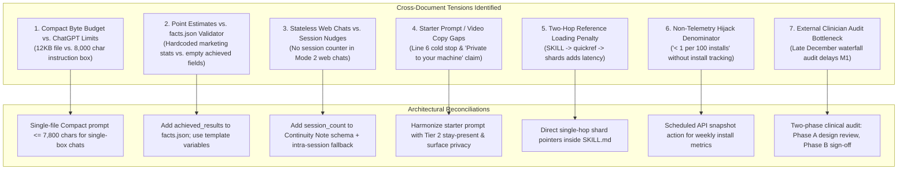

# Satori v6.5 Gap Analysis & Wayfinder Architectural Map

> **Document Version**: `6.5.0-GAP-ANALYSIS`  
> **Date**: October 2026  
> **Status**: Approved Planning & Architectural Specification  
> **Baseline Compared**: Satori `v6.1.8` (`github.com/MetcalfSolutions/Satori`)  
> **Target Specification**: Satori v6.5 Product Requirements Document (`6.5.0-PRD-r2`), Proposal Review Analysis (`satori_v6_5_proposal_review_analysis.md`), and Canonical Facts (`facts.json`)  
> **Target Output Path**: `docs/v6.5-planning/GAP_ANALYSIS.md`

---

## 1. Executive Summary & Architectural Delta

The transition from Satori v6.1.8 to v6.5.0 represents an evolution from a single-prompt companion library into a **cross-platform, safety-governed, dual-edition engineering system**.

| Architectural Dimension | v6.1.8 Baseline | v6.5.0 Target State |
|---|---|---|
| **Ecosystem Reach** | 8–10 loosely tracked CLI/IDE platforms; informal web copy; drifting counts in badges | **16 canonical environments** (10 Agent Harnesses, 6 Web Chat Surfaces) grouped into **Support Tiers A (Verified), B (Community), C (Experimental)**; all counts anchored in `facts.json` |
| **Model Calibration** | Five brittle behavioral profiles (`Profile 1` to `Profile 5`) based on model parameter heuristics and context limits | **Two Declared Editions (Satori Full & Satori Compact)** + **Two-Tier RECI Engine** (Active Hooks for verified CLI agents; Passive Observable-Signal Heuristics for web chats) |
| **Crisis & Harm Mitigation** | Binary crisis split (Standard reflection vs. Acute Hotline dump) | **Three-Tier Risk Model** (Tier 0 Dark Night, Tier 1 Risk Check-In, Tier 2 Acute Crisis with Tool Lockout + "Stay Present" handoff) + **Precedence Ladder** (Ranks 1–6) |
| **Memory Sovereignty** | SQLite FTS5 vault defaulting to `./.satori/memory/`; portable Markdown "Memory Capsule" | Vault defaults to **`~/.satori/memory/`**; cloud-sync folder detection (`--allow-synced`); **Data-Only Continuity Notes** (max 600 chars, strict 6-field allowlist, prompt-injection stripped); honest erasure technical specification |
| **Onboarding Protocol** | Rigid 5-question sequential intake form | **First-Run Resonance Engine**: Context-First Bypass, 3-stage collaborative attunement, "Satori Has Met You" milestone, Candor Floor fallback |
| **Verification & CI** | 21 static checks in `validate_skill.py`; 50-case trigger lint; 8 memory tests | **28-check expanded static suite**; **350-case Four-Strata Benchmark** (60 pos, 200 neg, 50 hybrid, 40 safety); **Pairwise LLM Judge Calibration** (Cohen's $\kappa \ge 0.60$) |
| **Distribution Packages** | Single web archive `SatoriSkill-v{version}.zip` | **Dual Release Zips**: `SatoriSkill-Full-v6.5.0.zip` and `SatoriSkill-Compact-v6.5.0.zip` with verified safety parity and LF line-ending enforcement |

---

## 2. Comprehensive Codebase Inventory & File Delta Map

### 2.1 Summary Matrix

- **Total Existing Files in v6.1.8**: 47 tracked files (excluding `.git` and release archives)
- **Files Requiring Modification**: **19 files**
- **Files to Add**: **10 files**
- **Files to Deprecate / Replace**: **3 files**

---

### 2.2 Files to Modify

| File Path | Current State (v6.1.8) | Required Modifications for v6.5.0 | Size / Budget Constraints | Dependencies / Blockers |
|---|---|---|---|---|
| `SKILL.md` | 7,985 bytes. Contains inline traditions table, 5-point pre-send check, binary crisis model, and Profile 1–5 self-detection. | 1. Move inline traditions table to `references/traditions-quickref.md` (-1,800 B).<br>2. Compress Section 1 into 4-line pointer block (-600 B).<br>3. Add Precedence Ladder table (+450 B).<br>4. Add Passive RECI heuristics (Voice, CoT, Code Editor, Search, Edition) (+600 B).<br>5. Add 4-question Honesty Self-Check (+350 B).<br>6. Add Continuity Note specification (+400 B).<br>7. Add Three-Tier Risk Model summary (+500 B).<br>8. Update frontmatter description with "psychologically grounded" and explicit negative triggers. | **Hard Cap: ≤ 8,000 bytes**<br>Target: ~7,400 bytes (with ~600 B safety buffer) | Blocks Category B mirrors (`build_release.py --sync`) |
| `references/core-compact.md` | 9,171 bytes. References Profile 5, 2-tier crisis model, lacks Precedence Ladder, Candor Floor, and Minor-Signal Rule. | Update to serve as the complete standalone operational spine for **Satori Compact**:<br>1. Add Three-Tier Risk Model & identical crisis table.<br>2. Add Precedence Ladder (Ranks 1–6).<br>3. Add Candor Floor, Minor-Signal Rule, and Single-Agent Invariant.<br>4. Add Continuity Note handling rules.<br>5. Align with ChatGPT Custom GPT character ceiling ($\le 7,800$ UTF-8 chars). | **Hard Cap: ≤ 12,000 bytes** ($\le 7,800$ chars if used as direct single-box prompt) | Verified for safety parity with `SKILL.md` by `validate_skill.py` |
| `references/clinical-spine.md` | 15,296 bytes. Contains legacy binary crisis flow, references old profile numbers. | 1. Replace binary crisis handling with Three-Tier Risk Model.<br>2. Integrate Candor Floor rules (§7.6).<br>3. Remove deprecated profile heuristics.<br>4. Re-verify helpline numbers against `references/crisis-sources.json`. | **Cap: < 24,000 bytes** (currently 15.3 KB — well within budget) | Depends on `crisis-sources.json` |
| `references/onboarding.md` | 7,766 bytes. Enforces 5-question intake sequence. | Replace entire intake sequence with **First-Run Resonance Engine** (§7):<br>1. Context-First Bypass (immediate jump to Steps 1–2 if emotional distress is detected).<br>2. 3-Stage Resonance Onboarding (Attunement $\rightarrow$ Collaborative Stance $\rightarrow$ Movement Anchor).<br>3. Per-Surface Memory Sovereignty Notices (Local Vault vs. Web Chat).<br>4. "Satori Has Met You" 3-sentence working formulation milestone.<br>5. Candor Floor guardrail. | **Cap: < 24,000 bytes** | Replaces legacy intake questions |
| `references/memory-system.md` | 10,200 bytes. Documents `./.satori/memory/` and "Memory Capsule". | 1. Update default vault location to `~/.satori/memory/` (§5.1, §9.3).<br>2. Document cloud-sync root detection and `--allow-synced` flag.<br>3. Replace "Memory Capsule" with **Continuity Note** specification (§5.2.1).<br>4. Document `import-note` and `export-note` CLI commands.<br>5. Detail honest Right to Erasure specification (`PRAGMA secure_delete=ON`, WAL checkpoint/truncate, `VACUUM`, and backup/snapshot limitations). | **Cap: < 24,000 bytes** | Coordinates with `satori_memory.py` |
| `references/model-calibration.md` | 9,706 bytes. Brittle Profile 1–5 self-detection heuristics and model-name tables. | 1. Decouple calibration from model parameter and checkpoint names.<br>2. Frame calibration around **Declared Editions (Full vs. Compact)**.<br>3. Document **Two-Tier RECI Engine** (Active Hooks vs. Passive Observable Heuristics).<br>4. Add Voice Rhythm Lock, CoT Empathy Gate, Code Editor Prose-Only Lock, and Search Restraint. | **Cap: < 24,000 bytes** | PRD §5.3 & §5.6 |
| `references/tone-and-voice.md` | 13,156 bytes. General tone instructions. | Align with `Satori Style Guide - 6.5.md`:<br>1. Formalize conversational anti-slop rules (no rule-of-three, no binary false contrasts, no conversational crutches).<br>2. Clarify separation between Conversational Output Register and Brand/Public Copy Register.<br>3. Enforce sensory warmth and concrete grounded metaphors. | **Cap: < 24,000 bytes** | Aligns with Style Guide |
| `references/crisis-sources.json` | 5,569 bytes. Contains primary-source crisis numbers and token requirements. | 1. Add `last_verified` ISO-8601 date fields to all entries.<br>2. Add staleness threshold (`staleness_warning_days: 120`).<br>3. Verify all helpline numbers for US (988, 741741), Canada (988, 686868), UK (111, 116 123, 85258), Ireland, Australia, NZ, India, and EU. | Valid JSON schema | Validated by `validate_skill.py` Check #5 |
| `references/SOUL.md` | 12,695 bytes. Canonical soul statement. | 1. Re-verify text to remove any "multi-agent council" remnants.<br>2. Re-assert Single-Agent Invariant (§5.4).<br>3. Note: SHA-256 hash must be recalculated and synced to `openclaw.plugin.json`. | **Cap: < 24,000 bytes** | Tracked by OpenClaw integrity lock |
| `references/traditions-quickref.md` | 17,998 bytes. Overview of traditions. | Receive the complete inline traditions table from `SKILL.md` during byte migration (§9.1a). Ensure total size remains strictly below 24,000 bytes. | **Cap: < 24,000 bytes** (must not exceed after table migration) | `SKILL.md` migration §9.1a |
| `scripts/validate_skill.py` | 256 lines, 21 checks. Hardcoded budgets, <=15 line pointer check, misses facts check. | Upgrade to **Tier 1 Expanded Static Analysis Suite (28 Checks)** (§11.1):<br>1. Read file budgets and environment counts dynamically from `facts.json`.<br>2. Check that ALL `references/*.md` files are strictly $\le 24,000$ bytes.<br>3. Resolve Category A Pointer Stub rule to accommodate `## Agent skills` (or evaluate stub structure).<br>4. Add crisis source staleness check (`last_verified` < 120 days).<br>5. Add cross-edition safety parity check (`SKILL.md` vs. `core-compact.md`).<br>6. Add quantitative claims verification matching doc assertions against `facts.json`. | Python 3.9+ stdlib | Critical build gate |
| `scripts/build_release.py` | 146 lines. Builds single zip `dist/SatoriSkill-v{version}.zip`, syncs 4 mirrors. | Upgrade release builder (§12.1):<br>1. Compile **Dual Release Zips**: `dist/SatoriSkill-Full-v6.5.0.zip` and `dist/SatoriSkill-Compact-v6.5.0.zip`.<br>2. Normalize all line endings to LF before archiving.<br>3. Synchronize `SKILL.md` across all 4 Category B mirrors.<br>4. Auto-update `references/SOUL.md` SHA-256 hash in `openclaw.plugin.json`.<br>5. Execute `validate_skill.py` as an exit gate. | Python 3.9+ stdlib | Release pipeline |
| `scripts/satori_memory.py` | 780 lines. Resolves `./.satori` before `~/.satori`; commands: `export-capsule`. | Upgrade memory engine (Epic 3, FR-3.1–3.5):<br>1. Default vault path to `~/.satori/memory/` (home directory).<br>2. Implement cloud-sync path detection (`OneDrive`, `Dropbox`, `Google Drive`, `iCloud`, `Box`) and require `--allow-synced` to proceed.<br>3. Replace `export-capsule` with `export-note` (Continuity Note schema: max 600 chars, strict 6-field allowlist).<br>4. Implement `import-note` command with schema validation, instruction-stripping, and confirmation prompt.<br>5. Keep `export-capsule` and `import-capsule` as deprecated aliases.<br>6. Ensure `forget` executes `PRAGMA secure_delete = ON`, WAL checkpoint/truncate, and `VACUUM`.<br>7. Update built-in `self-test` to cover all 8 v6.5 privacy checks. | Python 3.9+ stdlib (optional `cryptography` for encryption) | Self-test passes 8/8 |
| `scripts/run_evals.py` | 514 lines. 50 cases in 3 strata. | Upgrade evaluation harness (Tier 3, §11.3):<br>1. Support 350-case Four-Strata Benchmark.<br>2. Rename metrics to Activation Recall, Non-Activation Rate, and Hybrid Quality.<br>3. Implement Stratum 4 Safety eval (100% Acute Handoff, $\ge 90\%$ Dark Night No-Hotline).<br>4. Calculate 95% Wilson confidence intervals.<br>5. Write execution report to `evals/live_calibration_report.json`. | Python 3.9+ | Benchmark gate |
| `scripts/test_judge_calibration.py` | 179 lines. Evaluates 8 anchors in lint mode. | Upgrade judge calibration (Tier 4, §11.4):<br>1. Expand test set to 50 human-labeled response pairs.<br>2. Implement Cohen's $\kappa$ calculation targeting $\kappa \ge 0.60$. | Python 3.9+ | Quality gate |
| `hooks/hooks.json` | 17 lines. Uses relative path `python scripts/satori_memory.py status`. | Update hook definition (§5.1):<br>1. Replace relative command with absolute/plugin-root variable: `"${CLAUDE_PLUGIN_ROOT}/scripts/satori_memory.py status"`.<br>2. Ensure `enabled: false` remains default.<br>3. Guarantee hook injects zero personal context at session start. | JSON | Claude Code / Antigravity CLI |
| Category A Pointer Stubs (`AGENTS.md`, `CLAUDE.md`, `GEMINI.md`, `.cursor/rules/satori.mdc`, `.windsurf/rules/satori.md`, `.opencode/command/satori.md`) | Stub files pointing to `SKILL.md`. | Reconcile `<=15 line` limit with Matt Pocock's `## Agent skills` block (which added 15 lines). Refactor pointer stubs so they maintain pointer compactness while linking to `docs/agents/` in a single line, or adjust the validator rule to permit the skills block. | Line budget rule in `validate_skill.py` | Must pass `validate_skill.py` |
| Category B Skill Mirrors (`.agents/.../SKILL.md`, `.cursor/.../SKILL.md`, `.opencode/.../SKILL.md`, `.hermes/.../SKILL.md`) | Identical mirrors of root `SKILL.md`. | Re-synchronize byte-for-byte via `build_release.py --sync` after updating root `SKILL.md`. | SHA-256 match canonical `SKILL.md` | Enforced by Check #4 |
| Platform Manifests (`package.json`, `plugin.json`, `marketplace.json`, `gemini-extension.json`, `openclaw.plugin.json`, `.claude-plugin/plugin.json`, `.codex-plugin/plugin.json`, `.agents/plugins/satori/plugin.json`) | Various manifests at version `6.1.8`. OpenClaw mentions "councils". | 1. Bump version to `6.5.0`.<br>2. Update description from "Clinically informed" to "Psychologically grounded".<br>3. Remove "multi-agent council" from `openclaw.plugin.json` (Single-Agent Invariant).<br>4. Align categories with validated registry schemas. | JSON | Manifest sync in `build_release.py` |

---

### 2.3 Files to Add

| Proposed File Path | Purpose & Contents | PRD & Architecture Requirement | Target Size Budget |
|---|---|---|---|
| `facts.json` (Repo Root) | Move canonical facts from `docs/v6.5-planning/facts.json` to repository root. Single source of truth for all 16 environments, support tiers, benchmark gates, and byte budgets. | PRD §12.3, Proposal Review §3.2 | ~2.6 KB JSON |
| `SAFETY.md` | Comprehensive clinical safety policy, Three-Tier Risk Model, Candor Floor, Minor-Signal Rule, Over-Reliance Safeguards, and External Clinician Audit sign-off log (§10.8). | PRD §10, §10.8 | < 15 KB |
| `NOTICE.md` | Formal open-source attribution log crediting `obra/superpowers`, `anthropics/skills`, `sickn33/agentic-awesome-skills`, `blader/humanizer`, and `kepano/obsidian-skills`, with license recordings. | PRD §4, FR-5.5 | < 5 KB |
| `references/traditions-eastern.md` | Sharded reference file covering Buddhism, Taoism, and Hindu philosophy. | PRD §8 FR-1.4 (Sharding `traditions-deep.md`) | **< 24,000 bytes** |
| `references/traditions-stoic.md` | Sharded reference file covering Stoicism and Existentialism. | PRD §8 FR-1.4 (Sharding `traditions-deep.md`) | **< 24,000 bytes** |
| `references/traditions-african-sufi.md` | Sharded reference file covering Ubuntu, Kemetic *Ma'at*, Akan ethics, and Sufi wisdom. | PRD §8 FR-1.4 (Sharding `traditions-deep.md`) | **< 24,000 bytes** |
| `references/toolkit-inquiry.md` | Sharded reference file covering Socratic tension clarification, collaborative formulation, and IFS parts work. | PRD §8 FR-1.4 (Sharding `conversation-toolkit.md`) | **< 24,000 bytes** |
| `references/toolkit-somatic.md` | Sharded reference file covering somatic grounding, attunement, and DBT distress tolerance. | PRD §8 FR-1.4 (Sharding `conversation-toolkit.md`) | **< 24,000 bytes** |
| `evals/trigger_boundary_350.jsonl` | 350-case benchmark dataset across 4 strata (60 positives, 200 negatives, 50 hybrids, 40 safety) with $\ge 50\%$ held-out authoring. | PRD §11.3 | ~75 KB JSONL |
| `.github/workflows/metrics_snapshot.yml` | Weekly GitHub Action polling Releases API and Clones API to snapshot install counts into a persistent history file before the 14-day clone window expires. | PRD §1.4, Proposal Review §3.6 | YAML workflow |

---

### 2.4 Files to Deprecate or Remove

| File Path | Current Status | Deprecation / Removal Rationale | Replacement Artifact |
|---|---|---|---|
| `references/traditions-deep.md` | Active (79,107 bytes) | Exceeds the 24,000-byte universal rule ceiling by over 300%, causing token overflow and parsing failures in Antigravity / Gemini CLI. | Sharded into `traditions-eastern.md`, `traditions-stoic.md`, and `traditions-african-sufi.md`. |
| `references/conversation-toolkit.md` | Active (38,941 bytes) | Exceeds the 24,000-byte universal rule ceiling by 62%. | Sharded into `toolkit-inquiry.md` and `toolkit-somatic.md`. |
| `dist/SatoriSkill-v6.1.8.zip` | Shipped binary | Obsolete release artifact. | Replaced by `dist/SatoriSkill-Full-v6.5.0.zip` and `dist/SatoriSkill-Compact-v6.5.0.zip`. |

---

## 3. Analysis of Cross-Document Contradictions & Reconciliations

The review of `Satori 6.5 Product Requirements Document.md` (`6.5.0-PRD-r2`), `satori_v6_5_proposal_review_analysis.md`, `Satori 6.5 Expert Panel Review.txt`, and marketing assets reveals **seven primary tensions** that must be resolved:



### 3.1 Tension 1: Compact Edition Byte Budget vs. ChatGPT Custom GPT Character Limits
- **The Conflict**:
  - `PRD §5.6` & `§8 FR-1.2` define Satori Compact as `Compact SKILL.md` + `references/core-compact.md` capped at `12,000 bytes`.
  - `PRD §6.2` correctly notes that files uploaded to ChatGPT Custom GPT *Knowledge* are retrieved via RAG rather than loaded into context on Turn 1.
  - OpenAI Custom GPT `Instructions` enforce a hard ceiling of **8,000 characters**. A 12 KB file cannot fit inside the instruction box.
- **Resolution**:
  The Compact edition must be structured so that for single-box Web Chat surfaces (ChatGPT Custom GPT, Grok Web Project Instructions, DeepSeek system settings), **the entire self-contained Compact prompt fits inside a single file capped at $\le 7,800$ UTF-8 characters** (satisfying both the 8,000-character OpenAI limit and the 8,000-byte `SKILL.md` limit). `references/core-compact.md` remains available as an import target for CLI harnesses running small/local models.

### 3.2 Tension 2: Hardcoded Benchmark Numbers in Marketing Copy vs. `facts.json` Validator
- **The Conflict**:
  - `Marketing Copy Plan §4.1`, `§4.4`, and `Style Guide §3.3` hardcode specific point estimates: *"93.3% Recall"*, *"97.0% Non-Activation Rate (95% Wilson CI: [93.6%, 98.6%])"*, and *"88.0% Quality"*.
  - `PRD §8 FR-5.4` and `§11.1` mandate that `scripts/validate_skill.py` verifies character-for-character that all quantitative assertions match `facts.json`.
  - `facts.json` currently contains only target gates (`">=95%"`, `">=90%"`), not achieved values, because the 350-case benchmark has not yet been executed across 3+ Tier A models. Shipping hardcoded numbers before running the benchmark violates claims integrity.
- **Resolution**:
  Add an `achieved_results` object to `facts.json` (populated automatically by `scripts/run_evals.py` upon benchmark execution). Mark point estimates in marketing copy and style guides as variables or explicit targets until Milestone 1 evaluation produces `evals/live_calibration_report.json`.

### 3.3 Tension 3: Stateless Web Surfaces vs. the "Every 5 to 7 Substantive Sessions" Over-Reliance Rule
- **The Conflict**:
  - `PRD §10.6` requires that *"Every 5 to 7 substantive sessions, Satori quietly introduces a conversational nudge that explores how the user is sharing their insights with human friends..."*
  - `PRD §5.2.1` defines a strict 6-field allowlist for Continuity Notes (`theme`, `stance`, `lens`, `step`, `anchor_question`, `created`) and rejects unknown keys.
  - In Mode 2 (Web Chat), Satori has zero persistence across browser sessions unless a note is pasted. Without an allowlisted counter in the note, Satori cannot know when 5 to 7 sessions have elapsed.
- **Resolution**:
  1. Add an allowlisted integer field `session_count: <int>` to the Continuity Note schema in §5.2.1 (incremented each time a note is generated).
  2. Add an intra-session fallback rule for stateless web sessions: trigger the human-connection inquiry whenever a single session reaches $\ge 8$ substantive turns, or whenever a user requests an exported Continuity Note.

### 3.4 Tension 4: Safety & Privacy Copy Gaps in Starter Prompt and Demo Script
- **The Conflict**:
  - `Marketing Copy Plan §2.1.1` (60-Second Starter Prompt) line 6 states: *"If acute crisis, self-harm, or danger is present, halt reflection immediately and urge real-world human care."* This omits primary-source helpline numbers and contradicts the Tier 2 "Stay Present" rule (PRD §10.2: *"Do not abandon the user with a cold wall of silence"*).
  - `Marketing Copy Plan §2.1.3` (45-Second Demo Video) uses the voiceover: *"Private to your machine"*, but the video is embedded on the web chat landing page where conversations run on provider servers.
- **Resolution**:
  1. Update line 6 of the Starter Prompt to include primary-source helplines (`988`, `findahelpline.com`) and the stay-present posture.
  2. Update the web demo video voiceover to use the approved web surface strapline: *"Free, open-source, and zero tracking."*

### 3.5 Tension 5: Two-Hop Reference Loading Penalty from `SKILL.md` Sharding
- **The Conflict**:
  - `PRD §9.1a` migrates the traditions table out of `SKILL.md` to `references/traditions-quickref.md`.
  - When sharded, if `SKILL.md` only points to `traditions-quickref.md`, an agent needing Stoic philosophy must perform two sequential tool reads: `SKILL.md` $\rightarrow$ `traditions-quickref.md` $\rightarrow$ `traditions-stoic.md`. This introduces latency and tool-call failure risk.
- **Resolution**:
  Include a compact 3-line direct shard index inside `SKILL.md`'s Section 1 pointer block (costing < 220 bytes) that maps philosophical traditions and clinical frameworks directly to their target shard filenames (`traditions-stoic.md`, `traditions-eastern.md`, `toolkit-inquiry.md`), ensuring **single-hop progressive disclosure**.

### 3.6 Tension 6: Non-Telemetry Denominator for "< 1 per 100 Installs" Hijack Target
- **The Conflict**:
  - `PRD §1.4` targets `< 1 hijack report per 100 installs`, but Satori collects zero product telemetry, and GitHub's Traffic Clones API deletes statistics after 14 days. Without tracking release zip downloads and clone aggregates, the denominator cannot be calculated.
- **Resolution**:
  Create `.github/workflows/metrics_snapshot.yml` to query GitHub Releases and Traffic APIs weekly, appending cumulative totals to a version-controlled JSON record (`metrics/install_snapshots.json`).

### 3.7 Tension 7: Critical-Path Risk on External Clinician Audit Window
- **The Conflict**:
  - `PRD §13.2` schedules the External Clinician Audit for December 15–29, 2026. This falls across holiday closures and sits *after* the 350-case benchmark and release zips are generated. If the clinician requires adjustments to risk check-ins or wording, the entire 350-case benchmark would have to be re-run.
- **Resolution**:
  Split the clinical review into two distinct milestones:
  - **Phase A (Early November)**: Clinician design review of `SKILL.md`, `onboarding.md`, and the Three-Tier Risk Model *prior* to authoring and freezing the 350-case benchmark.
  - **Phase B (Early December)**: Final verification and sign-off in `SAFETY.md` after benchmark execution.

---

## 4. Impact on Verification Scripts, Manifests & Line Endings

### 4.1 Verification Scripts Impact

```
Current: 21 Checks (validate_skill.py) ────────► Target: 28 Checks (Expanded Tier 1 Suite)
Current: 50 Cases (run_evals.py)       ────────► Target: 350 Cases / 4 Strata (Wilson CI)
Current: 8 Unit Tests (satori_memory)  ────────► Target: 8 Tests + Cloud Detection + Note Roundtrip
Current: 8 Decoy Pairs (judge cal)     ────────► Target: 50 Pairs / Cohen's Kappa >= 0.60
```

#### 1. `scripts/validate_skill.py` (28 Automated Checks)
- **Check 1–4**: Frontmatter validation, negative triggers, name length, and forbidden phrase removal (`"When in doubt, activate"`).
- **Check 5–8**: Dynamic file size checks reading budgets directly from `facts.json` (`SKILL.md` $\le 8,000$ B, `core-compact.md` $\le 12,000$ B, and universal check verifying **every file in `references/*.md` is $\le 24,000$ bytes**).
- **Check 9–14**: Category A Pointer Stub verification.
  > [!WARNING]
  > **Immediate Collision Discovered**: Integration of Matt Pocock skills added a 15-line `## Agent skills` block to `CLAUDE.md` and `AGENTS.md`, immediately triggering `validate_skill.py` failures (lines exceeded 15). In v6.5, `validate_skill.py` must either:
  > 1. Adjust the Category A definition to allow an explicit `## Agent skills` sub-block up to 30 lines total, OR
  > 2. Compress the pointer stub so that `## Agent skills` references `docs/agents/` in a single line.
- **Check 15–18**: Category B Skill Mirror SHA-256 byte-identical validation against root `SKILL.md`.
- **Check 19–21**: Primary-source crisis table verification against `references/crisis-sources.json`, plus **staleness check** verifying `last_verified` is within 120 days.
- **Check 22–24**: Cross-Edition Safety Parity Check: verifies that `references/core-compact.md` contains the exact identical Three-Tier Risk Model, Precedence Ladder, Candor Floor, and helpline numbers as `SKILL.md`.
- **Check 25–26**: Relative Markdown link integrity and Git hygiene (`.gitignore` protects `.satori/`, `dist/`, `*.zip`).
- **Check 27**: `references/SOUL.md` SHA-256 integrity digest validation against `openclaw.plugin.json`.
- **Check 28**: Claims Register Validation: parses quantitative claims in documentation and asserts character-for-character equality with `facts.json`.

#### 2. `scripts/build_release.py`
- Must compile **two separate archives**:
  - `dist/SatoriSkill-Full-v6.5.0.zip`: `SKILL.md`, `README.md`, `CHANGELOG.md`, `PRIVACY.md`, `LICENSE.md`, `SAFETY.md`, `NOTICE.md`, and all `references/*.md` (including shards).
  - `dist/SatoriSkill-Compact-v6.5.0.zip`: `SKILL.md` (compact edition), `README.md`, `PRIVACY.md`, `LICENSE.md`, `SAFETY.md`, and `references/core-compact.md`.
- Must strip Windows `\r\n` line endings during packaging, ensuring all files inside archives use LF (`\n`) to prevent byte-budget inflation on Windows checkouts.

#### 3. `scripts/satori_memory.py`
- Shift default vault path from `./.satori/memory/` to `~/.satori/memory/`.
- Add cloud-sync root detection (`OneDrive`, `Dropbox`, `Google Drive`, `iCloud`, `Box`) and halt initialization unless `--allow-synced` is explicitly passed.
- Implement `export-note` and `import-note` commands with 6-field schema validation, instruction-stripping, and interactive confirmation.
- Keep `export-capsule` and `import-capsule` as deprecated aliases.
- Implement honest right to erasure (`PRAGMA secure_delete = ON`, checkpoint and truncate WAL, and `VACUUM`).

---

### 4.2 Manifest Files & Cross-Platform Alignment

The 16 canonical environments must be updated across their manifests to reflect version `6.5.0`:

| Platform / Manifest | Support Tier | Version Stamp | Key Schema Changes for v6.5 |
|---|:---:|:---:|---|
| `package.json` | Tier A | `6.5.0` | Update description to "Psychologically grounded"; update test scripts to include 350-case benchmark and judge calibration. |
| `.claude-plugin/plugin.json` | Tier A | `6.5.0` | Align with Anthropic marketplace category; verify absolute hook path. |
| `gemini-extension.json` | Tier A | `6.5.0` | Ensure extension points to canonical `GEMINI.md` pointer stub. |
| `.codex-plugin/plugin.json` | Tier A | `6.5.0` | Update skill metadata and documentation links. |
| `.agents/plugins/satori/plugin.json` | Tier A | `6.5.0` | Align with Google Antigravity discovery conventions. |
| `openclaw.plugin.json` | Tier B | `6.5.0` | Remove "multi-agent councils" (uphold Single-Agent Invariant); update `references/SOUL.md` SHA-256 digest. |
| `marketplace.json` | Tier A | `6.5.0` | Standardize category taxonomies across registries. |

---

### 4.3 Line-Ending (CRLF vs. LF) & Hash Validation Integrity

- **Root Cause of CRLF Inflation**: On Windows workstations, git checkouts may convert LF to CRLF if `core.autocrlf` is true. A 7,900-byte file with 100 lines becomes 8,000 bytes with CRLF, exceeding the 8,000-byte ceiling.
- **Mitigation Architecture**:
  1. `.gitattributes` already enforces `* text=auto eol=lf` and explicit `eol=lf` for `*.md`, `*.py`, `*.json`.
  2. `validate_skill.py` normalizes `replace(b"\r\n", b"\n")` before calculating size and SHA-256 hashes.
  3. `build_release.py` must normalize file contents to LF before writing to zip archives so that archives built on Windows remain byte-identical to archives built on Linux CI.

---

## 5. Wayfinder Architectural Map (Issue & Task Tracking)

This section maps the complete trajectory from the v6.1.8 baseline to the v6.5.0 PRD target state using the **Wayfinder** methodology (`wayfinder:map`).

```
                    ┌──────────────────────────────────────────────┐
                    │      WAYFINDER DESTINATION: SATORI 6.5       │
                    │   Pass 28 Checks • 350 Benchmark • Dual Zips  │
                    └──────────────────────┬───────────────────────┘
                                           │
         ┌─────────────────────────────────┴─────────────────────────────────┐
         ▼                                                                   ▼
┌─────────────────────────────────┐                         ┌─────────────────────────────────┐
│     FRONTIER: MILESTONE 1       │                         │       FOG: MILESTONE 2          │
│ • Ticket 1: Reference Sharding  │                         │ • Web Gem/Skill Zip Testing     │
│ • Ticket 2: Compact Spec        │                         │ • Meta AI Policy Review         │
│ • Ticket 3: facts.json & Checks │                         │ • Active Hooks for Tier B       │
│ • Ticket 4: Memory v6.5 Upgrade │                         │ • 15-Person Moderated Study     │
│ • Ticket 5: Clinician Outreach  │                         └─────────────────────────────────┘
│ • Ticket 6: 350-Case Benchmark  │
└─────────────────────────────────┘
```

### 5.1 Wayfinder Map Header

- **Destination**: Release of Satori v6.5.0 achieving 100% on the 28-check static analysis suite, $\ge 95\%$ Non-Activation Rate across 200 technical cases, 100% acute crisis handoff, Cohen's $\kappa \ge 0.60$ judge calibration, and dual release distribution (`dist/SatoriSkill-Full-v6.5.0.zip` and `dist/SatoriSkill-Compact-v6.5.0.zip`).
- **Notes**: Single-Agent Invariant is absolute. Zero telemetry. Three-Tier Risk Model and Precedence Ladder take precedence over all technical tasks.

---

### 5.2 Frontier Decision Tickets (Milestone 1 Core Gate)

The following tickets represent the immediate frontier of work. Each ticket resolves one focused technical decision or implementation package:

#### Ticket 1: Shard Oversized Reference Files below 24,000 Bytes
- **Label**: `wayfinder:task`
- **Question**: How should `references/traditions-deep.md` (79.1 KB) and `references/conversation-toolkit.md` (38.9 KB) be split into modular reference shards without breaking semantic coherence or progressive disclosure?
- **Scope**:
  - Split `traditions-deep.md` into `traditions-eastern.md`, `traditions-stoic.md`, and `traditions-african-sufi.md`.
  - Split `conversation-toolkit.md` into `toolkit-inquiry.md` and `toolkit-somatic.md`.
  - Wire single-hop pointers from `SKILL.md`.
  - Verify all files are strictly $< 24,000$ bytes.

#### Ticket 2: Compact Edition Single-File Specification
- **Label**: `wayfinder:research`
- **Question**: Can a single self-contained prompt artifact ($\le 7,800$ UTF-8 characters) serve both the `SatoriSkill-Compact-v6.5.0.zip` archive and single-box web chat surfaces (ChatGPT Custom GPT instructions) while maintaining 100% safety parity with Full `SKILL.md`?
- **Scope**:
  - Draft the unified Compact prompt.
  - Audit character count against ChatGPT 8,000-character ceiling.
  - Verify safety parity (Three-Tier Risk, Precedence Ladder, crisis numbers).

#### Ticket 3: Commit `facts.json` & Upgrade `validate_skill.py` to 28 Checks
- **Label**: `wayfinder:task`
- **Question**: How should `validate_skill.py` be refactored to read budgets and counts dynamically from `facts.json`, enforce the 24,000-byte reference rule, and reconcile the Category A pointer stub line count with Matt Pocock's `## Agent skills` block?
- **Scope**:
  - Move `facts.json` to repo root.
  - Implement dynamic budget parsing.
  - Update pointer stub validation logic to allow `docs/agents/` integration cleanly.
  - Add cross-edition safety parity check.

#### Ticket 4: Upgrade `satori_memory.py` to v6.5 Specifications
- **Label**: `wayfinder:task`
- **Question**: What modifications are required in `satori_memory.py` to shift default storage to `~/.satori/memory/`, detect cloud-sync folders (`--allow-synced`), and implement data-only Continuity Note import/export?
- **Scope**:
  - Update vault path resolution.
  - Add cloud folder inspection logic.
  - Implement `export-note` and `import-note` CLI commands with 6-field schema parsing.
  - Deprecate `export-capsule`/`import-capsule`.
  - Verify 8/8 self-test checks pass.

#### Ticket 5: External Clinician Review Phasing & Outreach
- **Label**: `wayfinder:research`
- **Question**: Who will conduct the licensed clinical psychologist audit (§10.8), and how do we phase the review into Phase A (design review in early November) and Phase B (sign-off in December) to prevent benchmark invalidation?
- **Scope**:
  - Identify clinician auditor candidates.
  - Prepare clinical audit briefing package.
  - Draft `SAFETY.md` template for clinical credentials and sign-off.

#### Ticket 6: Author 350-Case Four-Strata Benchmark & Wilson CI Harness
- **Label**: `wayfinder:task`
- **Question**: How should the 350 evaluation cases be partitioned (60 positives, 200 negatives, 50 hybrids, 40 safety) with $\ge 50\%$ held-out authoring, and how will `run_evals.py` compute 95% Wilson confidence intervals?
- **Scope**:
  - Author and partition 350 cases in `evals/trigger_boundary_350.jsonl`.
  - Implement Wilson score interval calculation in `run_evals.py`.
  - Wire automated JSON reporting to `evals/live_calibration_report.json`.

---

### 5.3 Not Yet Specified (Milestone 2 Ecosystem Expansion — "Fog of War")

The following items are in scope for v6.5 but sit beyond the Milestone 1 core gate:
- **Google Gemini Web Zip Upload Verification**: Testing whether Gemini Gems natively accept dual zip uploads or require text pasting.
- **xAI Grok Build & OpenClaw Active Hook Verification**: Testing deterministic `SessionStart` hooks in Grok Build and OpenClaw CLI environments.
- **Meta AI Platform & Youth-Safety Policy Audit**: Evaluating whether WhatsApp distribution can comply with minors safeguards (Tier C).
- **10-to-15 Person Moderated User Study**: Empirical qualitative study testing the "help you see more clearly" outcome measure (§1.4).

---

### 5.4 Out of Scope (Consciously Ruled Out)

The following items are permanently ruled out of the Satori v6.5 effort:
- **Autonomous Subagent Spawning**: Satori will never spawn background worker subagents during introspection sessions (Single-Agent Invariant).
- **Proprietary Cloud Sync**: Satori will never transmit memories or telemetry to a custom hosted backend.
- **In-Session User Rating / Feedback Prompts**: Satori will never interrupt personal reflection to ask for a star rating or product feedback.
- **Clinical Diagnosis or Prescriptive Medical Advice**: Satori remains an open-source introspective conversation partner, never a medical device or healthcare provider.

---

## 6. Pre-Implementation Checklist & Next Steps

Before writing code for Milestone 1, verify the following sequence:

1. [x] Run `@setup-matt-pocock-skills` and establish `docs/agents/` conventions.
2. [ ] Reconcile Category A Pointer Stub rule in `validate_skill.py` with `## Agent skills` block.
3. [ ] Commit `facts.json` to the repository root.
4. [ ] Shard `traditions-deep.md` and `conversation-toolkit.md` into modular files under 24,000 bytes.
5. [ ] Execute `SKILL.md` byte-budget migration (§9.1a) targeting ~7,400 bytes.
6. [ ] Upgrade `satori_memory.py` with home-directory vault default and Continuity Note schema.
7. [ ] Expand benchmark dataset to 350 cases across 4 strata.
8. [ ] Execute `validate_skill.py` and confirm 28/28 checks pass.
